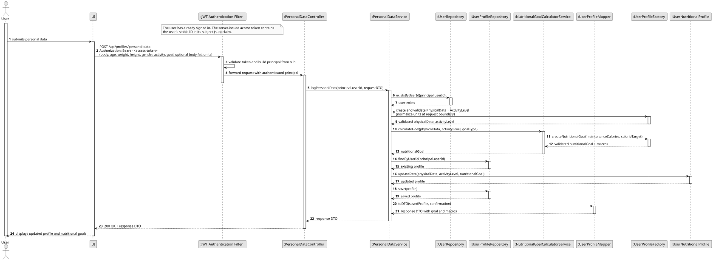

### US001 - Log Personal Data

## 1. Requirements Engineering


##### 1.1. User Story Description
As a User, I want to log my personal data (age, weight, height, gender, activity level), so that the application can use it as a baseline for my nutritional goals.

##### 1.2. Use Case Specifications
**From the user story:**
- The user profile must capture core physical and lifestyle attributes: age, weight, height, gender, and activity level.
- These attributes serve as the baseline input parameters required to compute personalized caloric and macronutrient goals.
- The system must support data persistence to ensure user details are stored securely within their profile.

**From the glossary and domain analysis:**
- **Physical Data:** The physical attributes of a user, such as age, weight, height, and gender, used to model nutritional needs and calculate goals.
- **Activity Level:** An evaluation of a user's daily physical activity and lifestyle intensity, used as a baseline parameter to calculate accurate nutritional and calorie goals.
- **User Profile:** The internal profile structure of a user, encapsulating their physical data and activity level.

##### 1.3. Acceptance Criteria
- **AC1:** All mandatory fields (age, weight, height, gender, activity level) must be provided and validated upon submission.
- **AC2:** Numeric values such as age, weight, and height must fall within realistic human physical limits (e.g., positive values, reasonable bounds).
- **AC3:** Saving the physical data must successfully update the user's profile and trigger the foundational state for nutritional goal generation.
- **AC4:** The system must persist the logged data correctly across sessions.

##### 1.4. Found out Dependencies

- **US008 (Authentication and Account Management):** The user must be authenticated to associate the physical data log with their specific user profile.

##### 1.5 Input and Output Data
**Input Data:**
- *Typed data:*
    - Age (integer, years)
    - Weight (double, kg)
    - Height (double, cm)
    - Gender (enumeration / category)
    - Activity Level (enumeration / category)
    - Pretended goal (Caloric surplus, deficit, maintenance etc.)
    - BodyFat percentage (optional) (double)

**Output Data:**
- Confirmation of successful profile and physical data logging.
- Suggested nutritional goal based on the logged data.
- Error messages in case of validation failures (e.g., "Invalid weight value", "Age must be positive").

##### System Sequence Diagram (SSD)


##### 1.7. Assumptions and Decisions


## 2. Analysis

### 2.1. Relevant Domain Model Excerpt
The following diagram illustrates the `User` and `UserProfile` aggregate components designed to handle physical data while maintaining domain boundaries.


## 3. Design

### 3.1. Rationale

| Architectural Component / Pattern          | Choice & Implementation                                                                                                    | Rationale & Benefit                                                                                                                            |
|:-------------------------------------------|:---------------------------------------------------------------------------------------------------------------------------|:-----------------------------------------------------------------------------------------------------------------------------------------------|
| **Value Object Encapsulation**             | Encapsulation of physical attributes (`PhysicalData`, `ActivityLevel`) and nutritional goals into immutable Value Objects. | Guarantees that invalid physical states (e.g., negative weights) cannot exist in memory, enforcing domain invariants before persistence.       |
| **Domain Service for Business Logic**      | Delegation of calorie and macro calculations to `NutritionalGoalCalculatorService`.                                        | Keeps domain services pure and business-focused, separating complex mathematical algorithms from entity state and data persistence.            |
| **Normalization at the Boundary**          | Handling unit conversions (Metric vs. Imperial) within the Factory layer before domain creation.                           | Keeps core business logic and domain calculations completely agnostic of representation units, avoiding conditional flags across the codebase. |
| **Factory Pattern for Complex Aggregates** | Use of `UserProfileFactory` to orchestrate validation, unit normalization, and profile assembly.                           | Decouples controllers and application services from complex instantiation logic while ensuring objects are always born in a valid state.       |
| **Independent Profile Aggregate**          | Linking `UserNutritionalProfile` to `User` exclusively via the business `UserId` value object.                             | Permits onboarding to evolve independently from core authentication records, allowing profiles to be created dynamically post-registration.    |

### 3.2. Design Decisions & Architecture

1. **Value Object Encapsulation for Physical Attributes**
   The attributes age, weight, height, gender, and activity level are encapsulated within the `PhysicalData` and `ActivityLevel` Value Objects. This guarantees that invalid physical states cannot be instantiated in the domain.

2. **Immutability and Domain Integrity**
   `PhysicalData` and related value objects are modeled as immutable. Any modification to a user's metrics results in the creation of a new valid instance, preserving strict domain integrity.

3. **Domain Service for Nutritional Calculation**
   The `NutritionalGoalCalculatorService` acts as a pure domain service. It receives validated value objects, executes the nutritional target algorithms, and returns a rich `NutritionalGoal` value object without touching persistence or controllers.

4. **Normalization at the Boundary (Unit Systems)**
   To support multiple measurement systems (Metric/Imperial) without polluting business logic, unit conversions happen strictly at the boundary (via the Factory or DTO mapping). The core domain logic exclusively processes normalized standard metrics.

5. **Factory Pattern for Profile Construction**
   To decouple application services from complex object graphs, `UserProfileFactory` handles assembling normalized inputs, validating bounds, and producing a fully valid `UserNutritionalProfile` aggregate.

6. **Decoupled Aggregate Association via Business ID**
   The `UserNutritionalProfile` references the core user via the `UserId` value object rather than a direct object reference. This ensures clean aggregate boundaries and allows onboarding (US001) to occur seamlessly as a distinct operational phase following user registration.

### 3.3. Sequence Diagram (SD)



## 4. Tests


### 4.1. Domain Validations (Bottom-Up Approach)


### 4.2. Application Layer & Integration Tests


## 5. Implementation

### 5.1. Overall Flow

1. **Input Submission:** The user submits personal data (age, weight, height, gender, activity level, goal type, optional body fat, and unit system preference) via the UI layer.
2. **Controller Orchestration:** `LogPersonalDataController` receives the request with the corresponding `userId` and delegates execution to the application service.
3. **Normalization & Value Object Creation:** `UserProfileFactory` normalizes incoming measurement units (Metric vs. Imperial) at the boundary and instantiates validated immutable value objects (`PhysicalData`, `ActivityLevel`).
4. **Domain Service Calculation:** `NutritionalGoalCalculatorService` computes Basal Metabolic Rate (BMR) using the Mifflin-St Jeor equation, scales it by the activity factor to obtain Total Daily Energy Expenditure (TDEE / maintenance calories), and applies the specific `GoalType` offset (cutting/bulking) to produce the final `NutritionalGoal`.
5. **Aggregate Construction & Persistence:** `UserProfileFactory` assembles the `UserNutritionalProfile` aggregate root (incorporating the physical data, activity level, and nutritional goal including maintenance calories), which is then persisted via `UserNutritionalProfileRepository`.
6. **Response Mapping:** `UserProfileMapper` converts the resulting domain data into a structured `NutritionalGoalResponseDTO` to be returned to the client UI.

### 5.2. Key Methods and Classes

| Class                              | Method                                                         | Responsibility                                                                                             |
|:-----------------------------------|:---------------------------------------------------------------|:-----------------------------------------------------------------------------------------------------------|
| `LogPersonalDataController`        | `logPersonalData(userId, PhysicalDTO)`                         | Entry point for logging personal data and triggering the onboarding/update flow.                           |
| `UserProfileFactory`               | `createPhysicalData(...)`, `createUserNutritionalProfile(...)` | Normalizes units, orchestrates value object validation, and builds the `UserNutritionalProfile` aggregate. |
| `PhysicalData`                     | `validateAndCreate(...)`                                       | Enforces physical domain invariants (age, weight, height, and body fat bounds).                            |
| `NutritionalGoalCalculatorService` | `calculateGoal(physicalData, activityLevel, goalType)`         | Executes BMR (Mifflin-St Jeor), TDEE scaling, and caloric target offset logic.                             |
| `UserNutritionalProfile`           | Aggregate Root Methods                                         | Manages internal state, linking physical metrics, activity levels, and calculated nutritional goals.       |
| `UserNutritionalProfileRepository` | `save(UserNutritionalProfile)`                                 | Persists the independent nutritional profile aggregate.                                                    |
| `UserProfileMapper`                | `toDTO(...)`                                                   | Maps domain results and confirmation messages into `NutritionalGoalResponseDTO`.                           |

### 5.3. Data Flow Example

```
User Input (Age, Weight, Height, Gender, Activity Level, Goal Type, Unit System)
↓
LogPersonalDataController.logPersonalData()
├─ UserRepo.findByUserId() (Validates user existence)
├─ UserProfileFactory (Unit normalization & PhysicalData/ActivityLevel VOs validation)
├─ NutritionalGoalCalculatorService.calculateGoal() (Computes BMR, TDEE, & target offsets)
├─ UserProfileFactory.createUserNutritionalProfile() (Assembles aggregate)
└─ UserNutritionalProfileRepository.save() → Persists independent profile aggregate
```