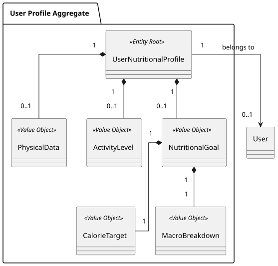

### US001 - Log Personal Data

## 1. Requirements Engineering


##### 1.1. User Story Description
As a User, I want to log my personal data (age, weight, height, gender, activity level), so that the application can use it as a baseline for my nutritional goals.

##### 1.2. Use Case Specifications
**From the user story:**
- The user profile must capture core physical and lifestyle attributes: age, weight, height, gender, and activity level.
- These attributes serve as the baseline input parameters required to compute personalized caloric and macronutrient goals.
- The system must support data persistence to ensure user details are stored securely within their profile.

**From the glossary and domain analysis:**
- **Physical Data:** The physical attributes of a user, such as age, weight, height, and gender, used to model nutritional needs and calculate goals.
- **Activity Level:** An evaluation of a user's daily physical activity and lifestyle intensity, used as a baseline parameter to calculate accurate nutritional and calorie goals.
- **User Profile:** The internal profile structure of a user, encapsulating their physical data and activity level.

##### 1.3. Acceptance Criteria
- **AC1:** All mandatory fields (age, weight, height, gender, activity level) must be provided and validated upon submission.
- **AC2:** Numeric values such as age, weight, and height must fall within realistic human physical limits (e.g., positive values, reasonable bounds).
- **AC3:** Saving the physical data must successfully update the user's profile and trigger the foundational state for nutritional goal generation.
- **AC4:** The system must persist the logged data correctly across sessions.

##### 1.4. Found out Dependencies

- **US009 (Authentication and Account Management):** The user must be authenticated to associate the physical data log with their specific user profile.

##### 1.5 Input and Output Data
**Input Data:**
- *Typed data:*
    - Age (integer, years)
    - Weight (double, kg)
    - Height (double, cm)
    - Gender (enumeration / category)
    - Activity Level (enumeration / category)
    - Pretended goal (Caloric surplus, deficit, maintenance etc.)
    - BodyFat percentage (optional) (double)

**Output Data:**
- Confirmation of successful profile and physical data logging.
- Suggested nutritional goal based on the logged data.
- Error messages in case of validation failures (e.g., "Invalid weight value", "Age must be positive").

##### System Sequence Diagram (SSD)


##### 1.7. Assumptions and Decisions


## 2. Analysis

### 2.1. Relevant Domain Model Excerpt
The following diagram illustrates the `User` and `UserProfile` aggregate components designed to handle physical data while maintaining domain boundaries.



## 3. Design

### 3.1. Rationale


### 3.2. Design Decisions & Architecture

1. **Value Object Encapsulation for Physical Attributes**
   The attributes age, weight, height, gender, and activity level are encapsulated within the `PhysicalData` Value Object. This guarantees that invalid physical states (such as negative weight or impossible heights) cannot be instantiated in the domain.

**2. Immutability of Value Objects**
`PhysicalData` is modeled as immutable. Any modification to a user's weight or height results in the creation of a new valid instance of the value object, preserving domain integrity.

**3. Factory Pattern for Profile Construction**
To decouple controllers from complex instantiation logic, a `UserProfileFactory` handles assembling the raw inputs into valid domain components.

**4. Secure Association with User Aggregate**
Physical data is strictly scoped inside the `User` aggregate root, ensuring that profile modifications go through proper root validation methods.

### 3.3. Sequence Diagram (SD)


## 4. Tests


### 4.1. Domain Validations (Bottom-Up Approach)


### 4.2. Application Layer & Integration Tests


## 5. Implementation

### 5.1. Overall Flow

1. **Input Submission:** The user submits age, weight, height, gender, and activity level via the UI layer.
2. **Controller Orchestration:** `LogPersonalDataController` receives the request and extracts user session context.
3. **Value Object Creation:** `PhysicalData` value object is built and validated against physical domain rules.
4. **Aggregate Update:** The `User` aggregate updates its `UserProfile` with the new validated `PhysicalData`.
5. **Persistence:** `UserRepository` saves the updated aggregate state to the database.

### 5.2. Key Methods and Classes

| Class                        | Method                                      | Responsibility                                                       |
|------------------------------|---------------------------------------------|----------------------------------------------------------------------|
| `LogPersonalDataController`  | `logPersonalData(UserDTO, PhysicalDTO)`     | Orchestrates validation, domain update, and persistence flow.        |
| `PhysicalData`               | `validateAndCreate(...)`                    | Validates physical constraints (age, weight, height bounds).         |
| `UserProfile`                | `updatePhysicalData(PhysicalData)`          | Updates internal profile attributes within the user aggregate.       |
| `UserRepository`             | `save(User)`                                | Persists the updated user aggregate.                                 |

### 5.3. Data Flow Example

```
User Input (Age, Weight, Height, Gender, Activity Level)
    ↓
LogPersonalDataController.logPersonalData()
    ├─ PhysicalData (Value Object Validation)
    ├─ User.updatePhysicalData()
    └─ UserRepository.save(User) → Persisted to Database
```