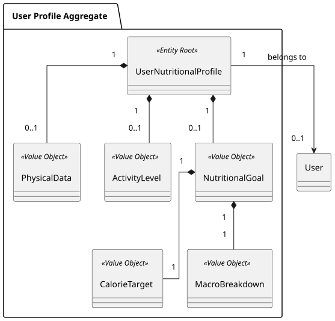
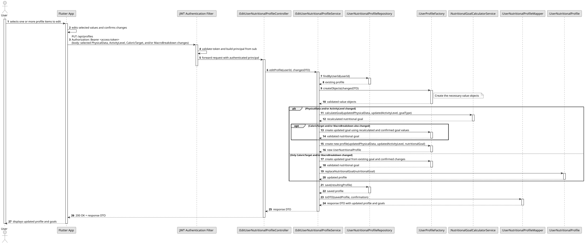

### US002 - Manual Goal Editing

## 1. Requirements Engineering


##### 1.1. User Story Description
As a User, I want to be able to manually edit my macro and calorie goals, so that I am not restricted by the predetermined goals calculated by the application.

##### 1.2. Use Case Specifications
**From the user story:**
- The user can choose one or more profile items to edit, including `PhysicalData`, `ActivityLevel`, and nutritional goals (`CaloricTarget` and `MacroBreakdown`).
- The user can change the selected items and confirm the changes together.
- Changes to `PhysicalData` and/or `ActivityLevel` require calculation of a new nutritional goal and creation of a new `UserNutritionalProfile`.
- Changes limited to `CaloricTarget` and/or `MacroBreakdown` update the nutritional goal without recalculating the profile.
- When a change includes both profile inputs (`PhysicalData` and/or `ActivityLevel`) and nutritional goals, the application calculates a new goal as part of creating the new profile.

**From the glossary and domain analysis:**
- **Nutritional Goals:** The calorie and macronutrient targets used to guide the user's nutrition tracking.
- **Calorie Goal:** The user's target energy intake, expressed in calories.
- **Macronutrient Goals:** The user's target intake for macronutrients, such as protein, carbohydrates, and fat.
- **User Profile:** The profile associated with the user's personal and nutritional information.
- **PhysicalData:** The user's physical attributes used as inputs to calculate nutritional goals.
- **ActivityLevel:** The user's activity classification used as an input to calculate nutritional goals.
- **UserNutritionalProfile:** The profile aggregate containing the user's physical data, activity level, and nutritional goal.

##### 1.3. Acceptance Criteria
- **AC1:** The user must be able to select one or more editable items (`PhysicalData`, `ActivityLevel`, `CaloricTarget`, and `MacroBreakdown`), edit the selected items, and confirm the changes.
- **AC2:** Submitted values must be validated before they are applied.
- **AC3:** If `PhysicalData` and/or `ActivityLevel` changes, the application must calculate a new nutritional goal and create a new `UserNutritionalProfile`.
- **AC4:** If only `CaloricTarget` and/or `MacroBreakdown` changes, the application must update the nutritional goal without recalculating the `UserNutritionalProfile`.
- **AC5:** If the changes include both `PhysicalData` and/or `ActivityLevel` and nutritional goal fields, the application must calculate the new goal and create a new profile incorporating the confirmed changes.
- **AC6:** The resulting changes must be persisted and used as the user's active profile and goals.
- **AC7:** The user must receive confirmation after changes are saved.
- **AC8:** If today's daily log already exists, a successful goal change must update that log's calorie and macronutrient target snapshot. Logs from previous dates remain unchanged.

##### 1.4. Found out Dependencies

- **US001 (Physical Profile Management):** Provides the user profile and predetermined nutritional goals that may be edited.
- **US008 (Authentication and Account Management):** The user must be authenticated so edits are associated with their account.

##### 1.5 Input and Output Data
**Input Data:**
- Selected item(s) to edit: `PhysicalData`, `ActivityLevel`, `CaloricTarget`, and/or `MacroBreakdown`.
- Updated values for each selected item, such as physical attributes, activity level, daily calorie target, and macronutrient breakdown.
- Confirmation to apply the selected changes.

**Output Data:**
- Confirmation that the nutritional goals were updated successfully.
- The updated profile and nutritional goals.
- Error messages in case of validation or persistence failures.

##### System Sequence Diagram (SSD)


##### 1.7. Assumptions and Decisions

- The user may select and edit one or more available profile items in a single editing flow, then confirm once.
- Changes to `PhysicalData` and/or `ActivityLevel` always trigger nutritional goal calculation and creation of a new `UserNutritionalProfile`.
- Changes only to `CaloricTarget` and/or `MacroBreakdown` replace the corresponding goal value(s) without recalculating the profile.
- Any explicit nutritional goal changes submitted together with physical data or activity level changes are incorporated into the newly calculated profile.
- Changes are applied to the authenticated user's profile after confirmation.
- After the profile update succeeds, today's existing daily log uses the updated calorie and macro targets; earlier daily logs retain the targets captured for their dates.


## 2. Analysis

### 2.1. Relevant Domain Model Excerpt
The following diagram illustrates the user nutritional profile and nutritional goal components involved in storing and updating a user's targets.



## 3. Design

### 3.1. Rationale

| Architectural Component / Pattern | Choice & Implementation | Rationale & Benefit |
|:-----------------------------------|:-----------------------|:--------------------|
| **Value Object Encapsulation** | Represent calorie and macronutrient targets as validated nutritional goal values. | Keeps goal values valid and centralizes domain rules. |
| **Application Service** | Coordinate selected edits, validation, profile recalculation when required, and persistence. | Applies all confirmed changes as one use case while keeping request handling separate from domain rules and storage. |
| **Conditional Profile Recalculation** | Recalculate and construct a new profile when `PhysicalData` or `ActivityLevel` changes; replace goal values directly when only goal fields change. | Recomputes derived goals when their inputs change and avoids unnecessary profile recalculation for manual goal-only edits. |
| **Repository Pattern** | Persist the updated goals through the user's nutritional profile repository. | Allows updated goals to be retrieved for subsequent application use. |
| **Same-day DailyLog Snapshot Refresh** | In the same transaction, update today's existing `DailyLog` target snapshot from the saved profile goal. | Keeps current-day progress aligned with confirmed goal edits while preserving historical daily targets. |
| **Authenticated User Context** | Associate the edit with the authenticated user's profile. | Ensures that each user updates their own goals. |

### 3.2. Design Decisions & Architecture

1. **Selected Changes and Confirmation**
   The user selects one or more profile items, edits their values, and confirms the complete set of changes before the application applies them.

2. **Recalculate When Profile Inputs Change**
   Any change to `PhysicalData` and/or `ActivityLevel` requires recalculating the nutritional goal and creating a new `UserNutritionalProfile`. If nutritional goal fields are also included, their confirmed changes are incorporated into the resulting profile.

3. **Direct Goal-Only Updates**
   When changes are limited to `CaloricTarget` and/or `MacroBreakdown`, create the corresponding updated goal value(s) and replace them without recalculating the profile.

4. **Persist Confirmed Changes and Refresh Today's Log**
   Persist the resulting profile and, if a daily log exists for today, replace its goal snapshot using the saved profile's calorie target and macro breakdown. Perform both updates in the same transaction. Do not alter logs for earlier dates, and do not create a log solely because goals changed.

5. **Preserve Profile Ownership**
   Associate all edits with the authenticated user's profile so each user updates only their own data.

### 3.3. Sequence Diagram (SD)



## 4. Tests


### 4.1. Domain Validations (Bottom-Up Approach)


### 4.2. Application Layer & Integration Tests


## 5. Implementation

### 5.1. Overall Flow

1. **Select and Edit:** The authenticated user selects one or more of `PhysicalData`, `ActivityLevel`, `CaloricTarget`, and `MacroBreakdown`, enters changes, and confirms.
2. **Authentication & Orchestration:** The token authentication filter validates the access token. The controller delegates the confirmed changes and authenticated user ID to the profile editing application service.
3. **Load & Validate:** The service loads the user's current profile and validates the selected changes.
4. **Apply Changes:** If `PhysicalData` and/or `ActivityLevel` changed, the service calculates a new nutritional goal and constructs a new profile incorporating any confirmed goal edits. If only goal fields changed, it creates the updated goal value(s) and replaces them without recalculating the profile.
5. **Persistence & Current-Day Sync:** The resulting profile is saved. If today's daily log exists, its target snapshot is refreshed from the saved goal in the same transaction; no log is created when none exists. Earlier logs are untouched.
6. **Response:** Return the updated profile and goals.

### 5.2. Key Methods and Classes

| Class | Method | Responsibility |
|:------|:-------|:---------------|
| `EditUserNutritionalProfileController` | `editProfile(principal.userId, ProfileChangesDTO)` | Entry point for confirmed profile edits. |
| `EditUserNutritionalProfileService` | `execute(userId, ProfileChangesDTO)` | Loads the profile, validates changes, applies goal-only edits or recalculates and constructs a new profile, then persists the result. |
| `PhysicalData` / `ActivityLevel` | Validated creation methods | Represent validated profile inputs used in goal calculation. |
| `NutritionalGoal` | Goal creation and validation methods | Represents and validates calorie and macronutrient targets. |
| `NutritionalGoalCalculatorService` | `calculateGoal(physicalData, activityLevel, goalType)` | Recalculates the goal when physical data or activity level changes. |
| `UserNutritionalProfileFactory` | `createProfile(...)` | Creates a new profile after recalculation when profile inputs change. |
| `UserNutritionalProfile` | Goal replacement / profile creation | Holds the resulting physical data, activity level, and nutritional goal. |
| `UserNutritionalProfileRepository` | `save(UserNutritionalProfile)` | Persists the updated nutritional profile. |
| `DailyLogRepository` | `findByUserIdAndDate(...)`, `save(DailyLog)` | Finds and updates today's log snapshot as part of the goal-edit transaction; prior dates are not queried or changed. |
| `DailyGoalSnapshot` / `DailyLog` | `from(NutritionalGoal)` / `updateGoalSnapshot(...)` | Builds and replaces the current day's calorie and macro target snapshot. |
| `UserNutritionalProfileMapper` | `toDTO(...)` | Maps the updated profile and operation result into the response. |

### 5.3. Data Flow Example

```
User selects and edits profile item(s), then confirms
↓
JWT Authentication Filter (validates bearer token, provides principal.userId)
↓
EditUserNutritionalProfileController.editProfile()
├─ EditUserNutritionalProfileService.execute()
├─ UserNutritionalProfileRepository.findByUserId()
├─ Validate selected changes
├─ If PhysicalData and/or ActivityLevel changed:
│  ├─ NutritionalGoalCalculatorService.calculateGoal()
│  ├─ Apply any confirmed CaloricTarget and/or MacroBreakdown edits
│  └─ UserNutritionalProfileFactory.createProfile() → New profile
├─ Else (goal fields only): create updated NutritionalGoal value(s) and replace them
├─ UserNutritionalProfileRepository.save() → Persists resulting profile
├─ DailyLogRepository.findByUserIdAndDate(today)
│  └─ If today's log exists: replace goal snapshot from saved profile and save in same transaction
└─ UserNutritionalProfileMapper.toDTO() → Returns updated profile and goals
```
