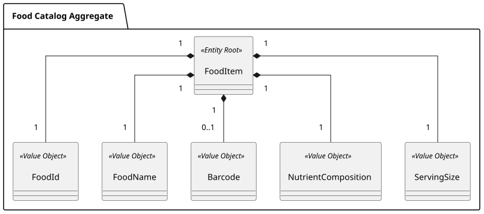

### US003 - Food Catalog

## 1. Requirements Engineering

##### 1.1. User Story Description
As a User, I want to be able to search through a catalog of multiple foods, so that I can find and select items to log.

##### 1.2. Use Case Specifications
**From the user story:**
- The user can input a search query (food name, brand, or barcode) to search through the food catalog.
- The application queries the Open Food Facts API and maps the external data into domain entities (`FoodItem`) and value objects (`FoodId`, `FoodName`, `Barcode`, `NutrientComposition`, `ServingSize`).
- The user receives a unified list of matching food items displaying their name, barcode, serving size, and nutritional composition.
- The user can select a specific food item from the results to view its details or select it for logging.

**From the glossary and domain analysis:**
- **FoodItem (Entity Root):** The core domain entity representing a consumable food item with a unique identity (`FoodId`).
- **FoodId (Value Object):** The unique identifier for a food item.
- **FoodName (Value Object):** The validated name/description of the food item.
- **Barcode (Value Object):** The optional product barcode used for scanning.
- **NutrientComposition (Value Object):** The breakdown of calories and macronutrients (protein, carbs, fats) per serving or per 100g.
- **ServingSize (Value Object):** The standardized portion size associated with the food item's nutritional values.

##### 1.3. Acceptance Criteria

- **AC1:** The user must be able to search for food items by keyword or barcode.
- **AC2:** The application must aggregate search results from multiple configured food data sources.
- **AC3:** Search results must be normalized into a unified DTO format regardless of the originating data source.
- **AC4:** If no food items match the search query, the user must receive a clear informational message.
- **AC5:** The user must be able to select a food item from the results list to inspect its complete nutritional breakdown.
- **AC6:** The search and selection process must be fast and responsive, handling external API timeouts gracefully.

##### 1.4. Found out Dependencies
- **US008 (Authentication and Account Management):** The user must be authenticated to perform searches and interact with logging features.
- **External Network Access:** Required for querying external food catalog APIs.

##### 1.5. Input and Output Data
**Input Data:**
- Search term (string) or barcode (string).
- Optional filters (e.g., source preference, category).

**Output Data:**
- A list of matching food items with summary nutritional data.
- Detailed nutritional profile of a selected food item.
- Error or empty state messages when searches yield no results or upstream APIs fail.

##### 1.6. System Sequence Diagram
*(Placeholder for US003-SSD.svg)*

##### 1.7. Assumptions and Decisions
- External API responses will be mapped to internal domain value objects/DTOs to avoid tight coupling with third-party schemas.
- Caching strategies will be introduced to minimize redundant network calls for frequent searches.
- More than one API´s may be used simultaneously to provide a comprehensive catalog. 

## 2. Analysis

### 2.1. Relevant Domain Model Excerpt


## 3. Design

### 3.1. Rationale

| Architectural Component / Pattern | Choice & Implementation                                                                 | Rationale & Benefit                                                                                         |
|:----------------------------------|:----------------------------------------------------------------------------------------|:------------------------------------------------------------------------------------------------------------|
| **Adapter Pattern**               | Dedicated client adapters for each external food API (`OpenFoodFactsAdapter`).          | Isolates third-party API specifics, authentication rules, and payload parsing from the core business logic. |
| **Facade / Aggregator Service**   | `FoodCatalogService` coordinates simultaneous queries across all active adapters.       | Unifies multi-source search into a single coherent operation for the application layer.                     |
| **Data Normalization**            | Map diverse external JSON schemas into a unified internal `FoodItemDTO` / domain model. | Ensures consistent data representation for the UI and downstream logging use cases (US002/US004).           |

### 3.2. Design Decisions & Architecture
1. **Decoupled Integration:** Each external food source operates independently behind a common interface, allowing new providers to be added or removed without impacting the application core.
2. **Resilience & Fault Tolerance:** Integration with external APIs includes timeout configurations and exception handling so that a failure in one provider does not crash the entire search transaction.

### 3.3. Sequence Diagram (SD)
*(Placeholder for US003-SD.svg)*


## 4. External Food Catalog APIs & Multi-Source Architecture

### 4.1. Overview of Integrated APIs
Currently FitMaxxer will only implement one food catalog API, although additional sources will be added in the future:
1. **Open Food Facts:** Global crowd-sourced database, ideal for packaged goods and barcode scanning worldwide.

The system is preppared to support multiple external APIs, allowing for a more diverse and comprehensive catalog, therefore the following diagram illustrates the overall architecture.


### 4.2. How It Works (Architectural Flow)

```
User Search Query ("Bread" or Barcode)
↓
FoodCatalogController
↓
FoodCatalogAggregatorService (Concurrent Dispatch)
├── OpenFoodFactsClient ──> [Open Food Facts API]
├── AnotherAPIClient ──> [Another API]
↓
Result Normalization & Deduplication
↓
Unified FoodCatalogResponseDTO -> Returned to User/UI
```


## 5. Tests

### 5.1. Domain Validations (Bottom-Up Approach)
- Test query sanitization and barcode format validation.

### 5.2. Application Layer & Integration Tests
- Test aggregator behavior when all APIs succeed.
- Test graceful degradation when one or more external API clients time out or return errors.
- Test DTO mapping consistency across different source payloads.


## 6. Implementation

### 6.1. Overall Flow
1. **User Request:** The user submits a search string or barcode via the UI/CLI.
2. **Orchestration:** The controller delegates the query to the `FoodCatalogAggregatorService`.
3. **Multi-Source Dispatch:** The service queries all configured API adapters (Open Food Facts, FatSecret, MFDS, EuroFIR, INSA).
4. **Normalization & Aggregation:** Responses are parsed, normalized into common DTOs, merged, and filtered.
5. **Presentation:** The unified search results are presented to the user for selection.

### 6.2. Key Methods and Classes

| Class                           | Method              | Responsibility                                                               |
|:--------------------------------|:--------------------|:-----------------------------------------------------------------------------|
| `FoodCatalogController`         | `searchFood(query)` | Entry point for catalog search requests.                                     |
| `FoodCatalogAggregatorService`  | `search(query)`     | Coordinates concurrent calls across all API adapters and merges results.     |
| `OpenFoodFactsAdapter` (et al.) | `fetchFoods(query)` | Communicates with the specific external API and maps raw data.               |
| `FoodItemDTO`                   | N/A                 | Represents the unified, standardized food item structure across all sources. |