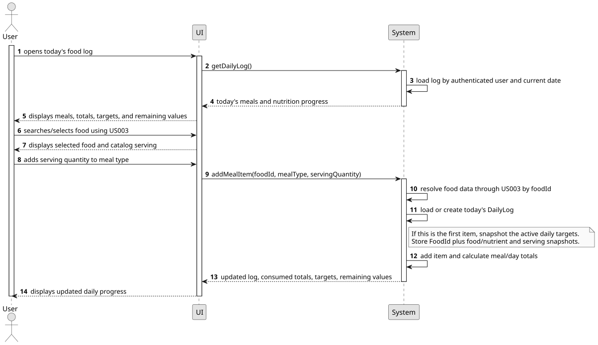
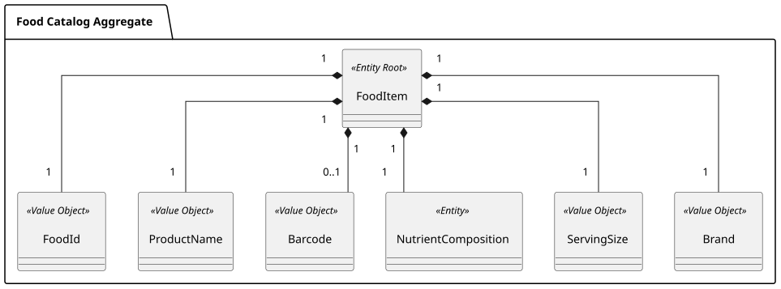
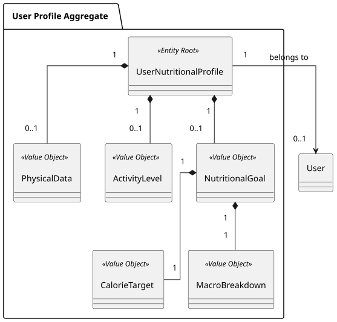

### US004 - Meal Logging and Daily Tracking

## 1. Requirements Engineering

##### 1.1. User Story Description
As a User, I want to log foods I eat today and see my calorie and macronutrient progress, so that I can track my intake against my daily goals.

##### 1.2. Use Case Specifications
**From the user story:**
- The user can view today's log and its foods grouped under meals.
- The user can select a food from the catalog, choose a meal type, and log a quantity based on the serving definition supplied by the catalog.
- The system creates and persists today's `DailyLog` when its first food item is added.
- The user can organize items under `Breakfast`, `Lunch`, `Dinner`, and `Snacks`; multiple snack entries are allowed.
- The user can see a daily summary/progress visualization of calories and macronutrients consumed today alongside today's targets and remaining amounts.

**From the glossary and domain analysis:**
- **DailyLog (Aggregate Root):** The authenticated user's log for the current calendar date. It owns its meals and meal items.
- **Meal:** A grouping of meal items by a supported meal type; multiple snack entries are permitted.
- **MealType (Value Object):** One of `Breakfast`, `Lunch`, `Dinner`, or `Snacks`.
- **MealItem (Entity):** One food consumption recorded in a meal, with its `FoodSnapshot` and catalog-defined serving quantity.
- **FoodSnapshot (Value Object):** Immutable, log-time food details owned by a `MealItem`, including name, optional brand/barcode, nutrient values and basis, and catalog serving definition. It has no identity or separate lifecycle.
- **PortionQuantity (Value Object):** A positive numeric count or multiplier of the serving defined by the food catalog. Flexible gram, milliliter, item-count, and custom serving conversions are deferred to US012.
- **FoodItem (Aggregate Root):** A catalog item provided by US003. Its catalog lookup key is used to resolve the item when logging; the `DailyLog` stores copied food details as `FoodSnapshot`, not the `FoodItem` or its `FoodId`.
- **Daily Nutritional Summary:** Today's calories and macronutrients consumed and their remaining/over-target values.

##### 1.3. Acceptance Criteria
- **AC1:** An authenticated user can view today's meals and daily nutritional summary.
- **AC2:** The user can add a food item found through US003 to `Breakfast`, `Lunch`, `Dinner`, or `Snacks`, using a positive quantity of the catalog-defined serving.
- **AC3:** The system creates and persists today's `DailyLog` when its first item is added; subsequent additions update that same log.
- **AC4:** The system scales the food's calorie and macronutrient values from the catalog-provided serving/nutrient basis by the logged serving quantity. If required data for the calculation is missing or incompatible, the system reports that the food cannot be logged with a calculated nutrition value.
- **AC5:** The daily summary/progress visualization displays calories, protein, carbohydrates, and fat consumed, today's corresponding targets, and remaining values. Negative remaining values indicate an exceeded target. This is a current-day view, not a multi-day trend graph.
- **AC6:** Meal items retain their food name, nutrient values/basis, and serving definition as captured when logged. Today's target values are retained in the log so catalog or profile changes do not silently rewrite the day's record.
- **AC7:** The supported meal types are `Breakfast`, `Lunch`, `Dinner`, and `Snacks`; multiple snack entries are allowed. User-defined meal types are out of scope.
- **AC8:** Today's log is accessible only to its authenticated owner.
- **AC9:** US004 only adds meal items. Editing or removing meals/items is outside this story and reserved for US009.

##### 1.4. Found out Dependencies
- **US001 (Physical Profile Management):** Provides the user's nutritional profile and initial calorie/macronutrient goals.
- **US002 (Manual Goal Editing):** Provides the active goals to snapshot when today's log is first created.
- **US003 (Food Catalog):** Finds foods and supplies their identifiers, names, serving definitions, nutrient values, and nutrient basis.
- **US008 (Authentication and Account Management):** Supplies the authenticated user identity used to own today's log.
- **US012 (Flexible Portion Quantities):** Adds quantities and conversions beyond catalog-defined serving counts, including grams, milliliters, item counts, and named custom portions.

##### 1.5. Input and Output Data
**Input Data:**
- Food catalog item identifier selected from US003.
- Meal type: `Breakfast`, `Lunch`, `Dinner`, or `Snacks`.
- Positive serving quantity/multiplier based on the selected food's catalog serving definition.

**Output Data:**
- Today's meals and logged food details.
- Daily and per-meal calories, protein, carbohydrates, and fat consumed.
- Today's calorie and macronutrient targets and remaining/over-target values.
- Confirmation that a meal item was added.
- Validation, unavailable-food, ownership, and persistence error messages.

##### 1.6. System Sequence Diagram (SSD)



##### 1.7. Assumptions and Decisions
- US004 covers viewing today's log and adding items to it. Browsing previous daily logs is US005; longer-term trends are US007; editing or removing meals/items is US009.
- One `DailyLog` is identified by the authenticated user and today's calendar date. It is created and persisted with the first item and reused for subsequent additions.
- `Breakfast`, `Lunch`, and `Dinner` are single groupings for today. `Snacks` can contain multiple entries. Custom meal types are deferred.
- Portion quantity is a positive numeric count/multiplier of the selected food's catalog-defined serving. Explicit gram/milliliter quantities, item-count conversions, and custom named servings (for example, “one whole chicken”) are deferred to US012.
- Nutrition calculation uses the serving and nutrient basis supplied by US003. US003 must expose compatible serving/nutrient data; US004 does not invent missing conversions or nutrient values.
- The request uses a catalog lookup key only to resolve the selected food through US003. The persisted `MealItem` contains a `FoodSnapshot` and `PortionQuantity`; it does not retain `FoodId` or a reference to the `FoodItem` aggregate. An available barcode is copied into the snapshot as descriptive data.
- On first item creation, the log stores the active calorie and macro targets. Daily progress is calculated as target minus logged intake; profile goals themselves are not decremented or mutated.
- Negative remaining values communicate that intake exceeded a target.


## 2. Analysis

### 2.1. Relevant Domain Model Excerpt
The daily log aggregate owns meals and meal items and references the user and nutritional profile. Each meal item owns a `FoodSnapshot` and portion value; it has no association to the Food Catalog aggregate.

[Meal and Daily Log aggregate source](../global-artifacts/domainModel/domainModelExcerpts/puml/meal-and-daily-log-aggregate.puml)





The `MealItem` has no reference to the `FoodItem` aggregate. US003's catalog lookup key is used only while adding the item; the log persists the resulting `FoodSnapshot` value object. `DailyLog` still references the user's profile by ID and stores the daily goal snapshot.

## 3. Design

### 3.1. Rationale

| Architectural Component / Pattern       | Choice & Implementation                                                                                       | Rationale & Benefit                                                                                      |
|:----------------------------------------|:--------------------------------------------------------------------------------------------------------------|:---------------------------------------------------------------------------------------------------------|
| **DailyLog Aggregate Root**             | `DailyLog` owns today's `Meal` and `MealItem` entities and enforces date, ownership, and item-addition rules. | Keeps a day's food entries and totals consistent within one aggregate boundary.                          |
| **Catalog Boundary Mapping** | Resolve a selected catalog key to a temporary US003 DTO, then copy relevant fields into `FoodSnapshot`. | Keeps the external Food Catalog aggregate outside `DailyLog` while preserving the data needed for historical logs. |
| **Profile Identity Reference** | `DailyLog` keeps the profile identity and a daily goal snapshot, not the profile aggregate object. | Avoids coupling the log lifecycle to the profile while retaining the goals used for that day. |
| **Log-Time Snapshots**                  | Store food name, serving/nutrient values and basis, plus today's target values.                               | Prevents later catalog or profile edits from silently changing today's logged intake.                    |
| **Serving-Based Portion Quantity**      | Store a positive quantity of the selected food's catalog-defined serving.                                     | Supports basic logging and calculation while leaving flexible unit conversions to US012.                 |
| **Derived Daily Summary**               | Calculate consumed and remaining values from today's items and target snapshot.                               | Shows current progress without mutating nutritional goals or persisting stale totals.                    |
| **Repository Pattern**                  | Load/save today's log by authenticated user identity and date.                                                | Reuses the same log throughout the day and enforces one log per user/date.                               |
| **Authenticated Ownership**             | Resolve the user from the authenticated principal, not a client-supplied owner ID.                            | Prevents one user from reading or changing another user's log.                                           |

### 3.2. Design Decisions & Architecture

1. **Today's log and adding items are the scope.** US004 reads today's log and adds items to it. Previous-day browsing belongs to US005, trend analysis to US007, and all meal/item edits and removals to US009.
2. **Create on first item.** Opening the daily view can return an empty, non-persisted state. The application creates and saves `DailyLog` when the user adds the first food item.
3. **The catalog supplies food details; the log owns snapshots.** The application uses a selected catalog lookup key to retrieve trusted food details through US003. `MealItemFactory` copies the relevant values into a `FoodSnapshot` value object. The log stores neither `FoodId` nor a `FoodItem` aggregate reference.
4. **Use catalog-defined servings in this story.** `PortionQuantity` is a positive numeric serving count/multiplier. Users cannot enter arbitrary units or custom serving conversions until US012.
5. **Scale nutrition using the provided basis.** Calculate the item's contribution from its serving quantity and the serving/nutrient data from US003. Reject unavailable or incompatible data rather than displaying fabricated totals.
6. **Snapshot today's targets.** When the first item creates the log, copy the active profile's calorie and macro targets into the log. Later profile changes do not silently change this day's progress.
7. **Derive progress.** Calculate consumed totals from logged items and remaining values as target minus consumed.
8. **Meal types are fixed.** Support `Breakfast`, `Lunch`, `Dinner`, and repeatable `Snacks`; user-defined types are out of scope.
9. **US004 is add-only.** It does not edit or remove meals or meal items. Those operations are reserved for US009.

### 3.3. Sequence Diagram (SD)

[US004 SD source](./US004_SD.puml)


## 4. Tests

### 4.1. Domain Validations (Bottom-Up Approach)
- Validate `MealType` against the four supported values and reject unsupported/custom values.
- Validate positive serving quantities and reject zero or negative values.
- Verify serving-count nutrient scaling for supported product nutrient bases, including fractional serving counts.
- Reject foods that lack sufficient serving/nutrient data to calculate a reliable contribution.
- Verify `DailyLog` user/date ownership and meal-item addition behavior.
- Verify daily and per-meal totals and remaining values, including over-target negative values.
- Verify food and target snapshots remain unchanged after source catalog/profile values change.

### 4.2. Application Layer & Integration Tests
- Opening today's empty log does not persist an empty `DailyLog`; adding the first item creates and persists it.
- Adding another item today loads and updates the existing log.
- Add flows require an authenticated owner and reject access to another user's log.
- Adding a food uses the selected catalog lookup key through US003 and stores the expected `FoodSnapshot` and nutrient values.
- Per-meal and daily totals reflect newly added serving quantities.
- Today's target snapshot remains stable if the active profile changes after the log is created.
- Persistence enforces one daily log per user/date and round-trips nested meals/items and snapshots.
- Food lookup, profile lookup, validation, and persistence failures produce clear errors without partially saving a log.


## 5. Implementation

### 5.1. Overall Flow

1. **Open today's log:** The authenticated user opens the daily view. The application loads today's log by the authenticated user and date; if none exists, it returns an empty view without persisting a log.
2. **Find a food:** The user searches the catalog using US003 and selects a returned food item. The client submits its catalog lookup key, not trusted nutrient values.
3. **Choose meal and serving quantity:** The user selects `Breakfast`, `Lunch`, `Dinner`, or a `Snacks` entry and enters the number of catalog-defined servings.
4. **Load or create and add:** The application loads today's log. If this is the first item, it loads the active profile, snapshots today's targets, and creates the log. It resolves the selected catalog key through US003, creates a `FoodSnapshot` and `MealItem`, and adds it to the selected meal.
5. **Calculate progress:** The domain calculates item nutrients from the serving quantity and catalog nutrient basis. The response returns per-meal and daily totals plus targets and remaining values.

### 5.2. Key Methods and Classes

| Class / Component                           | Method / Responsibility                                                                                                          |
|:--------------------------------------------|:---------------------------------------------------------------------------------------------------------------------------------|
| `DailyLogController`                        | Authenticated endpoints for reading today's log and adding meal items.                                                           |
| `DailyLogApplicationService`                | Orchestrates owner/date lookup, US003 food resolution, profile target snapshotting, item addition, calculation, and persistence. |
| `AddMealItemRequestDTO`                     | Carries the selected catalog lookup key, meal type, and catalog-serving quantity from the client.                                |
| `FoodCatalogDetailsDTO` (US003 query result)| Temporarily carries trusted food details to the logging service; it is not persisted in the log.                                 |
| `DailyLogFactory`                            | Creates a new `DailyLog` with user/date identity and the initial target snapshot when today's first item is added.                |
| `MealItemFactory`                            | Creates a `FoodSnapshot` value object and validated `MealItem` from the US003 DTO and serving quantity.                           |
| `DailyLog`                                  | Aggregate root that owns the date, meal groupings, target snapshot, added items, and derived totals.                             |
| `Meal`                                      | Groups meal items by `MealType`; allows multiple `Snacks` entries.                                                               |
| `MealItem`                                  | Holds `FoodSnapshot`, `PortionQuantity`, and calculated nutrient contribution.                                                   |
| `FoodSnapshot`                              | Immutable value object with food name, optional brand/barcode, nutrients/basis, and catalog serving definition.                  |
| `PortionQuantity`                           | Validates a positive numeric count/multiplier of the catalog-defined serving.                                                    |
| `NutrientScalingService`                    | Calculates calories and macros for the serving quantity using the snapshot's nutrient basis and serving data.                    |
| `FoodCatalogQueryService` (US003)            | Resolves the selected catalog lookup key to a temporary `FoodCatalogDetailsDTO`; this query contract is proposed for logging.    |
| `UserNutritionalProfileRepository`          | Retrieves the active goal values used to initialize today's target snapshot.                                                     |
| `DailyLogRepository`                        | Loads and saves today's log by owner and date; enforces a unique log per user/date.                                              |
| `DailyLogMapper`                            | Maps an existing log or an empty current-day view into `DailyLogResponseDTO`.                                                     |
| `DailyLogResponseDTO`                       | Returns today's meals, consumed nutrient totals, targets, and remaining values.                                                   |

### 5.3. Data Flow Example

```
User selects a food and adds 3 catalog servings to Breakfast
↓
DailyLogController (authenticated principal.userId)
├─ DailyLogApplicationService
│  ├─ DailyLogRepository.findByUserIdAndDate(userId, today)
│  ├─ FoodCatalogQueryService.getFoodDetails(catalogLookupKey)
│  ├─ If absent: UserNutritionalProfileRepository.findByUserId(userId)
│  │  └─ DailyLogFactory.create(userId, today, profile ID, target snapshot)
│  ├─ MealItemFactory creates FoodSnapshot from name, optional brand/barcode,
│  │  nutrient basis/values, and catalog serving definition
│  ├─ MealItemFactory creates MealItem(FoodSnapshot, PortionQuantity(3 servings))
│  ├─ DailyLog.addMealItem(Breakfast, mealItem)
│  ├─ Calculate nutrient totals and target-minus-consumed progress
│  ├─ DailyLogRepository.save(dailyLog)
│  └─ DailyLogMapper.toDTO(dailyLog, progress)
└─ Return updated daily log and nutritional summary
```
