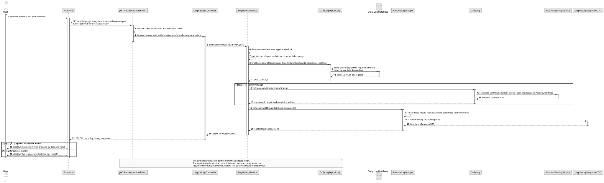

### US005 - Daily History

## 1. Requirements Engineering

##### 1.1. User Story Description
As a User, I want to see the past history of my daily logs, so that I can review what I ate on previous days.

##### 1.2. Use Case Specifications
**From the user story:**
- The authenticated user can review saved daily logs for a selected month and year.
- A past log shows the foods recorded for that date, grouped by meal, in the same format used to review today's log.
- The user can distinguish each log by its date and review its daily nutrition summary.

**From the glossary and domain analysis:**
- **DailyLog (Aggregate Root):** One user's log for one calendar date. It owns the meals and meal items recorded for that date.
- **Meal:** A grouping of meal items by `Breakfast`, `Lunch`, `Dinner`, or `Snacks`.
- **MealItem:** A recorded food and quantity, with its log-time `FoodSnapshot` and `PortionQuantity`.
- **FoodSnapshot (Value Object):** The food name, optional brand/barcode, nutrient values and basis, and catalog serving definition captured when the item was logged.
- **DailyGoalSnapshot (Value Object):** The calorie and macro targets associated with that daily log.
- **DailyNutritionSummary:** The logged intake, that date's target snapshot, and remaining/over-target values calculated for the selected day.

##### 1.3. Acceptance Criteria
- **AC1:** An authenticated user can request history for a specific month and year.
- **AC2:** The application validates that the month and year are valid, not in the future, and within the supported history window.
- **AC3:** The application returns only the authenticated user's saved logs in the requested month, ordered newest first. If the selected month is the current month, today's log is excluded.
- **AC4:** Each displayed log includes its date, foods grouped by meal, logged quantities and units, and its daily nutrition summary.
- **AC5:** A past log uses the food and target snapshots stored with that log. Changes to the food catalog or the user's current profile do not rewrite history.
- **AC6:** The history contains only logs owned by the authenticated user. A user cannot retrieve another user's logs.
- **AC7:** If the selected month contains no saved logs, the application returns an empty history and the CLI explains that no logs are available for that month.
- **AC8:** US005 is read-only. Adding items remains in US004; editing or removing historical entries remains outside this story.

##### 1.4. Found out Dependencies
- **US004 (Meal Logging and Daily Tracking):** Creates and persists daily logs, meals, meal items, food snapshots, portion quantities, and daily target snapshots.
- **US008 (Authentication and Account Management):** Supplies the authenticated user identity used to scope history queries and protect log ownership.

##### 1.5. Input and Output Data
**Input Data:**
- Authenticated user identity from the security principal.
- Requested month and year, supplied as GET query parameters.
- No client-supplied user ID or current date is accepted.

**Output Data:**
- Saved daily logs from the requested month, ordered from most recent to oldest.
- For each date: meals and their food items, quantities and units, nutrient details, daily totals, target values, and remaining/over-target values.
- An empty result when there are no saved logs for the requested month.
- Validation errors for invalid, future, or out-of-range month/year requests.
- Authentication, authorization, and persistence error responses as applicable.

##### 1.6. System Sequence Diagram (SSD)

##### 1.7. Assumptions and Decisions
- History consists of dates for which a `DailyLog` was actually persisted. Dates with no log are omitted rather than shown as empty days.
- The user selects a month and year. These values are sent as GET query parameters; GET requests do not carry a request body.
- The application derives the current date and the selected month's date range using its configured clock and timezone. Today's log is excluded when the requested month is the current month.
- Invalid months, future months, and requests outside the supported history window are rejected. The maximum lookback window is a product configuration to be defined before implementation.
- Logs are returned newest first so the user sees the most recent activity in that month first.
- The repository query is bounded to one month and scoped to the authenticated user.
- Historical values come from the persisted `FoodSnapshot` and `DailyGoalSnapshot`; history does not call US003 or read the user's current nutritional profile.
- The selected log's consumed totals and remaining values are calculated using that log's recorded foods and target snapshot.
- All meal types supported by US004, including multiple `Snacks` entries, are retained in the historical display.
- US005 does not change the daily log persistence model or allow historical log edits.

## 2. Analysis

### 2.1. Relevant Domain Model Excerpt
The existing `DailyLog` aggregate is already the unit of persisted daily history. Each log has a user identity and date, owns its meals and meal items, and stores the target snapshot used for that date. Each meal item owns the food and portion data captured when it was logged.

History can therefore be read from persisted `DailyLog` aggregates and mapped to the existing daily-log response shape. Each `DailyLog` has its food and target snapshots and can calculate the logged intake and remaining values for its date without consulting the current food catalog or profile. The response mapper maps those results into transport DTOs.

## 3. Design

### 3.1. Rationale

### 3.2. Design Decisions & Architecture

### 3.3. Sequence Diagram (SD)

## 4. Tests

### 4.1. Domain Validations (Bottom-Up Approach)

### 4.2. Application Layer & Integration Tests

## 5. Implementation

### 5.1. Overall Flow

### 5.2. Key Methods and Classes

### 5.3. Data Flow Example
