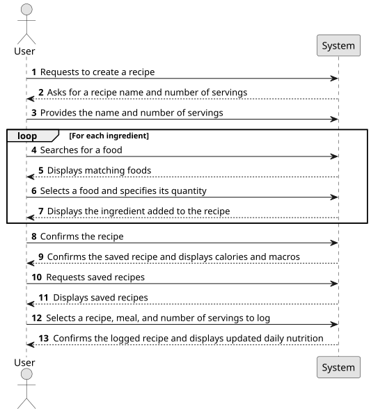
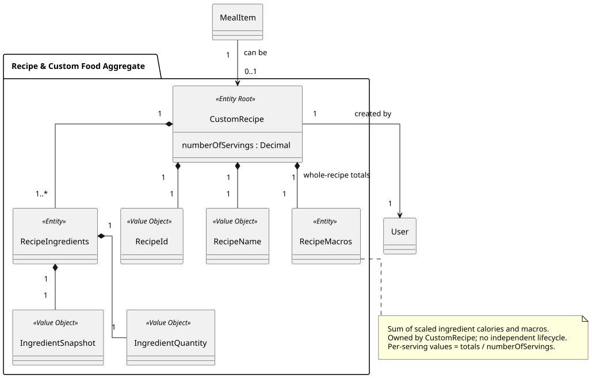
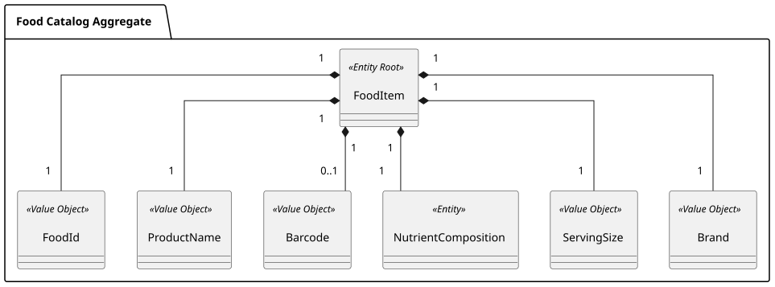
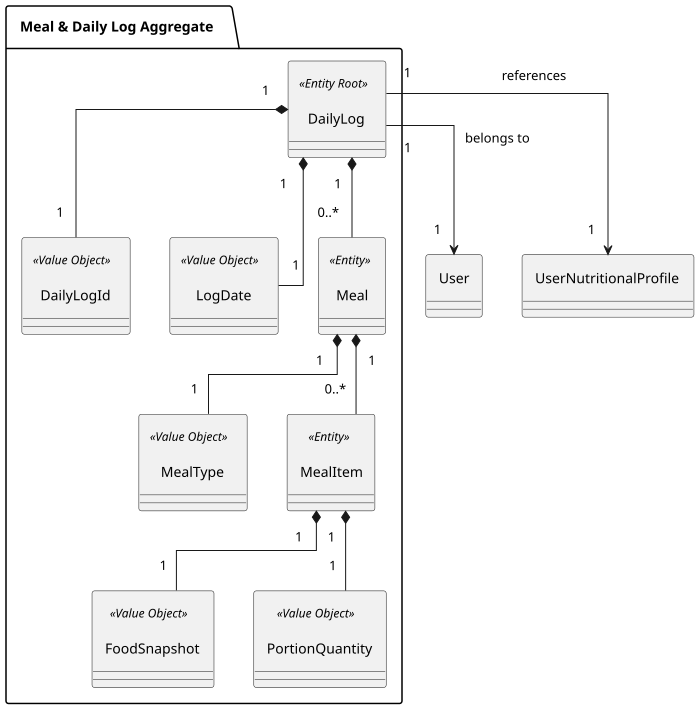
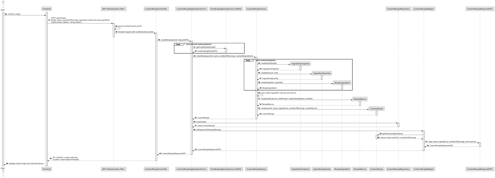

### US006 - Custom Foods and Recipes

## 1. Requirements Engineering

##### 1.1. User Story Description
As a User, I want to be able to create my own custom foods, ingredients, and recipes, so that I can log items that are not available in the public catalog.

##### 1.2. Use Case Specifications
**From the user story:**
- The authenticated user can create a named recipe by selecting ingredients through US003 and specifying each ingredient's quantity.
- The user specifies how many servings the complete recipe produces.
- The application calculates and persists the recipe's calories, protein, carbohydrates, and fat, together with the ingredient snapshots used to calculate them.
- The user can browse their saved recipes, inspect ingredients and nutrition, and select a recipe for logging through US004.
- The user can manually create a custom food with a serving definition and calorie/macronutrient values when the food is absent from US003. A saved custom food can be logged directly or selected as a recipe ingredient.

**From the glossary and domain analysis:**
- **CustomRecipe (Aggregate Root):** A reusable, user-owned preparation containing ingredient entries, a recipe yield, and persisted whole-recipe nutrition totals.
- **RecipeIngredient (Entity):** One ingredient row owned by a recipe, with local identity, an immutable food snapshot, and a positive portion quantity.
- **IngredientSnapshot (Value Object):** Recipe-owned copied name, optional brand/barcode, calories, macros, nutrient basis, and serving definition. It does not require a live association to its source food.
- **IngredientQuantity (Value Object):** Recipe-owned positive amount and compatible unit used to scale an ingredient or log a food.
- **numberOfServings (CustomRecipe attribute):** Positive number of servings produced by the complete recipe; no separate value object is created.
- **RecipeMacros (Entity):** Persisted whole-recipe calories and grams of protein, carbohydrates, and fat, calculated from ingredient snapshots and quantities.
- **CustomFood (Aggregate Root):** A user-owned food definition whose nutrition and serving basis are entered manually. It is separate from an ingredient row and from the external catalog.

##### 1.3. Acceptance Criteria
- **AC1:** An authenticated user can create a recipe with a nonblank name, at least one ingredient, and a positive serving yield. A single-ingredient recipe is permitted.
- **AC2:** Ingredients can be selected using US003 or from the user's saved custom foods. Each entry requires a positive quantity and a supported unit: servings, grams, or milliliters.
- **AC3:** The server resolves ingredient details and calculates each contribution using its nutrient basis and compatible quantity. Missing required nutrition, unavailable foods, or incompatible units prevent saving; missing values are never silently replaced with zero.
- **AC4:** Saving persists the recipe owner, identity, name, yield, ingredient identities, food snapshots, quantities, and whole-recipe calorie/macro totals atomically.
- **AC5:** The user can list their saved recipes and inspect a recipe's ingredients, whole-recipe nutrition, yield, and per-serving nutrition. Reading a saved recipe requires no external catalog call.
- **AC6:** US004 lets the user select a saved recipe, choose a supported meal type, and log a positive number of recipe servings, including fractions. The daily summary includes its calories and all three macros.
- **AC7:** Recipe nutrition remains unchanged if an external ingredient changes or becomes unavailable. A logged recipe also retains its log-time name, serving definition, and nutrition independently of its source recipe.
- **AC8:** A user cannot list, inspect, use as an ingredient, or log another user's recipes or custom foods. Ownership is taken from authentication, never from a request body.
- **AC9:** The user can save a custom food with a nonblank name, positive serving definition, supported nutrient basis, and complete nonnegative calorie/protein/carbohydrate/fat values; zero is valid when explicitly supplied. They can subsequently list, inspect, log it, or select it as a recipe ingredient.
- **AC10:** A failed ingredient lookup, validation, or database write leaves no partial recipe or daily-log addition persisted.
- **AC11:** Existing US003 catalog search and US004 food logging continue to work with their current request contract. Empty personal lists return an empty result and an explanatory CLI message.

##### 1.4. Found out Dependencies
- **US003 (Food Catalog):** Searches ingredients and resolves selected catalog identifiers into normalized food details.
- **US004 (Meal Logging and Daily Tracking):** Provides daily logs, meal types, food snapshots, quantity scaling, target snapshots, and daily summaries. US006 extends its supported item sources.
- **US005 (Daily History):** Must continue reading logged recipe/custom-food snapshots without consulting their current definitions.
- **US008 (Authentication and Account Management):** Supplies the owner identity for personal foods and recipes.
- **US001/US002:** Supply active nutritional goals when logging creates today's first daily log, as already required by US004. Creating a recipe or custom food does not itself require a nutritional profile.
- **US012 (Flexible Portion Quantities):** Broader named/count-based portions remain deferred.

##### 1.5. Input and Output Data
**Input Data:**
- Authenticated identity from the security principal.
- Recipe name, positive yield in servings, and ingredient entries: source (`CATALOG` or `CUSTOM_FOOD`), source identifier, positive quantity, and unit.
- For a custom food: name, optional descriptive brand, serving quantity/unit, nutrient basis, calories in kcal, and protein/carbohydrate/fat in grams for that basis.
- For logging: selected recipe/custom-food identifier, meal type, quantity, and supported unit. Recipes accept servings only in this story.

**Output Data:**
- Created recipe/custom-food identifier and persisted details.
- Personal recipe/custom-food lists and detail responses.
- For a recipe: ingredient rows, snapshots and quantities, yield, whole-recipe totals, and calculated per-serving values.
- US004's existing daily-log response after a recipe/custom-food addition.
- Validation, authentication, not-found, external-source-unavailable, and persistence errors as applicable.

##### 1.6. System Sequence Diagram (SSD)



[PlantUML source](US006_SSD.puml)

##### 1.7. Assumptions and Decisions
- A recipe represents one complete preparation, not one meal occurrence. Its nutrition is the sum of the selected ingredient contributions; yield determines the fraction represented by one serving.
- Catalog ingredients and custom-food ingredients are captured at recipe creation. Saving and reading recipes must not depend on cache retention or continued availability of source foods.
- Recipe servings are abstract divisions of the batch. No gram/milliliter logging of recipes is offered without a measured final yield. Ingredient mass cannot establish cooked weight because cooking can change it.
- Duplicate ingredient rows are allowed and have distinct identities; they are not implicitly merged by food ID or snapshot equality.
- Recipe editing/deletion, ingredient editing after save, nested recipes, public sharing, cooking instructions, and automatic cooking-loss/retention adjustments are outside this story. Ingredient identities support future row-level operations without introducing those endpoints now.
- The broader backlog wording includes manual custom foods. They are included here as a separate, small aggregate, rather than requiring users to manufacture a recipe for a food with manually supplied nutrition.

## 2. Analysis

### 2.1. Relevant Domain Model Excerpt





`CustomRecipe` owns identified ingredient rows and a `RecipeMacros` entity, and stores `numberOfServings` as an attribute. Each ingredient owns its food snapshot and quantity. `CustomFood` has a separate aggregate boundary and stores manually supplied food details. Snapshot copying is a creation-time dependency; neither ingredient rows nor logged meal items retain live source associations.


## 3. Design

### 3.1. Rationale

| Architectural Component / Pattern | Choice & Implementation | Rationale & Benefit |
|:----------------------------------|:------------------------|:--------------------|
| **Recipe aggregate** | `CustomRecipe` owns identified ingredient rows, yield, and persisted total nutrition. | Defines the transaction and invariant boundary for one reusable preparation. |
| **Snapshot ingredients** | Copy resolved food values into each ingredient. | Recipes survive catalog changes, outages, and cache eviction. |
| **Stored nutrition** | Persist whole-recipe totals; derive per-serving values from totals/yield. | Makes saved calorie/macro values explicit while avoiding two independently stored totals. |
| **Personal custom food** | Separate `CustomFood` root with owner and manual nutrition definition. | Supports unavailable foods as ingredients or directly logged items. |
| **Shared scaling rules** | Reuse existing nutrient-basis and portion conversion behavior. | Prevents recipe and daily-log calculations from disagreeing. |
| **Log-time snapshot** | Convert saved recipe nutrition to a per-serving `FoodSnapshot`. | Reuses US004/US005 summaries and preserves historical independence. |

### 3.2. Design Decisions & Architecture
1. **Use owner-scoped repositories.** Resolve identity from the JWT subject and query recipes/custom foods by both identifier and owner. Missing and foreign-owned identifiers return the same not-found response. Lists are owner-scoped and paginated.
2. **Resolve ingredients on the server.** `CustomRecipeApplicationService` obtains catalog details through the existing `FoodCatalogQueryService` or an owner-scoped custom-food query. Request DTOs contain references and quantities, not authoritative catalog nutrient values. Manual values are accepted only through custom-food creation.
3. **Separate lookup from aggregate construction.** Resolve and validate all ingredient definitions before building the root. `CustomRecipeFactory` creates ingredient snapshots, validates scaling, calculates totals, and constructs a valid recipe. Save the root and children together in a short database transaction; avoid holding a write transaction across external API calls.
4. **Keep value objects within their aggregate boundaries.** Recipe ingredient rows own `IngredientSnapshot` and `IngredientQuantity`; `FoodSnapshot` and `PortionQuantity` remain inside `DailyLog`. Recipe calculation uses its own ingredient values and the same nutrient-basis/conversion rules. Logging maps saved recipe nutrition into a new DailyLog `FoodSnapshot`; no shared domain-object package or shared snapshot table is introduced. Persist a `RecipeMacros` child entity, owned exclusively by `CustomRecipe`, for whole-recipe calorie and macro totals. It has an identity and no independent repository or lifecycle.
5. **Keep recipe invariants in the root/factory.** No caller supplies persisted totals. Whole-recipe nutrition equals the sum of scaled snapshots. If editing is introduced later, recompute totals in the same aggregate operation and transaction as the ingredient change. Explicitly map nonnegative nutrients and positive quantity/yield constraints.
6. **Use decimal calculations.** Use `BigDecimal`; retain at least the existing scaling precision (10 decimal places for division, `HALF_UP`) and declare sufficient database precision/scale. Do not round each ingredient to display precision before summing. Display rounding must not feed subsequent calculations. For logging, calculate per-serving nutrients with the same division policy and verify fractional-serving results within the declared precision.
7. **Persist the complete definition.** Proposed tables are `custom_recipe` (ID, owner, name, number_of_servings), `recipe_macros` (ID, unique recipe foreign key, four totals), `recipe_ingredient` (ID, root foreign key, position, snapshot columns, quantity/unit), and `custom_food` (ID, owner, definition columns). Ingredients and `RecipeMacros` cascade with their root; ingredients retain order. The root saves ingredient changes and recalculated totals atomically. Index personal-list queries by owner; no foreign key points to an external catalog food.
8. **Provide personal endpoints.** Proposed API: `POST /api/recipes`, `GET /api/recipes?page=0&size=20`, `GET /api/recipes/{recipeId}`, with equivalent creation/list/detail endpoints under `/api/custom-foods`. Creation returns `201 Created` with a Location header; reads return `200 OK`. Validate pagination and bound page size. Invalid definitions return `400`; unresolved items return `404`; upstream availability failures use the existing catalog error mapping.
9. **Extend logging with explicit source endpoints.** Preserve `POST /api/daily-log/today/items` and `AddMealItemRequestDTO` unchanged for catalog logging. Add `POST /api/daily-log/today/recipe-items` with `{recipeId, mealType, quantity}` (recipe servings), and `POST /api/daily-log/today/custom-food-items` with `{customFoodId, mealType, quantity, quantityUnit}`. Both reuse the existing log creation, goal snapshot, meal grouping, calculation, and save path after resolving an owned source.
10. **Snapshot the recipe as one food item.** Build a snapshot with recipe name, no fabricated brand/barcode, `PER_SERVING` basis, nutrient values `recipeMacros / numberOfServings`, and serving definition `1 serving`. Store the requested serving count as the meal item's portion. Persist one meal item, not a second copy of every ingredient in the daily log. Log reads have no recipe lookup dependency.
11. **Keep catalog search focused.** US003 still searches external foods. The CLI offers catalog ingredients or personal custom foods during recipe creation, and catalog foods, custom foods, or recipes when logging. Do not inject private recipe records into the public food catalog/cache.
12. **Keep custom-food rules explicit.** Support the existing `PER_SERVING`, `PER_100_GRAMS`, and `PER_100_MILLILITERS` bases with a valid serving definition. A positive measured serving must match its basis when conversion is needed. Missing nutrients are invalid; grams-to-milliliters conversion is never assumed. Nested recipe selection is excluded, avoiding recursion and cycles.

### 3.3. Sequence Diagram (SD)



The draft follows the catalog-ingredient happy path: create and persist a recipe, browse saved recipes, and hand off logging to US004. `CustomRecipeMapper` and `CustomRecipeResponseDTO` are proposed response-mapping components, following the other user stories.

## 4. Tests

### 4.1. Domain Validations (Bottom-Up Approach)
- Reject blank names, empty recipes, null/missing nutrients, negative nutrient values, and zero/negative quantities or yields. Accept explicitly zero nutrients and fractional yields/amounts.
- Calculate ingredient contributions for per-serving, per-100g, and per-100ml definitions; reject missing conversions and incompatible units.
- Verify whole-recipe totals, division by yield, fractional logged servings, and rounding boundaries using known numeric examples.
- Verify duplicate ingredients remain separate identified rows and input collection mutation cannot alter a saved aggregate.
- Verify root/factory construction cannot accept client-supplied totals or an inconsistent recipe definition.

### 4.2. Application Layer & Integration Tests
- Create, flush, clear the persistence context, and reload a recipe; verify ingredient snapshots/quantities/order, yield, and all four stored totals.
- Create a custom food; reload it, use it in a recipe, and log it directly with supported quantities.
- Verify owner-scoped list/detail/ingredient/logging requests, foreign-owned IDs, missing IDs, unauthenticated requests, and empty/paginated lists.
- Verify recipe creation fails atomically on an invalid/unavailable ingredient and on persistence failure, with no partial root/children.
- Change the catalog response or evict its cache after saving a recipe; reload and log the recipe with external catalog access disabled and verify unchanged nutrition.
- Log a recipe twice with different serving counts, including a fraction; verify one meal item per addition, meal and daily totals, and today's first-log goal snapshot behavior.
- Verify a recipe/custom-food change in test setup does not alter an already persisted meal snapshot; US005 reads history without source lookups.
- Run existing catalog, daily-log, and history regression tests after introducing recipe-owned nutrition types and the additional logging paths.
- Verify HTTP status/Location behavior and CLI flows for recipe creation, personal selection, and recipe serving entry.

## 5. Implementation

### 5.1. Overall Flow
1. Introduce recipe-owned `IngredientSnapshot` and `IngredientQuantity`, preserving DailyLog value objects and validating consistent nutrient-basis/conversion rules.
2. Introduce manual `CustomFood` creation, owner-scoped persistence, list/detail API, and CLI selection.
3. Introduce recipe value objects, `RecipeIngredient`, `CustomRecipe`, factory, and aggregate persistence mapping.
4. Implement recipe creation using US003/custom-food resolution, immutable ingredient snapshots, validated quantities, yield, and server-calculated persisted totals.
5. Add personal recipe list/detail endpoints and the CLI recipe builder. The CLI keeps an unsaved local draft until submission; failed creation does not persist a partial recipe.
6. Add owner-scoped recipe/custom-food logging endpoints and snapshot mapping while sharing the existing daily-log addition logic.
7. Verify persistence, ownership, scaling, snapshot independence, and existing US003/US004/US005 behavior.
8. Update the global domain-model source and relevant rendered diagrams during implementation: replace plural `RecipeIngredients` with identified ingredient rows, add yield/nutrition and the custom-food root, and remove the live meal-item-to-recipe association. Snapshot copying should be shown as a creation-time dependency, not a persistent catalog association.

### 5.2. Key Methods and Classes

| Class / Component | Method / Responsibility |
|:------------------|:------------------------|
| `CustomRecipeController` | Authenticated recipe creation, paginated personal list, and detail endpoints. |
| `CustomRecipeApplicationService` | Resolve ingredient sources, enforce ownership, coordinate construction and persistence. |
| `CustomRecipeFactory` | Create identified ingredient rows and a valid root with server-calculated nutrition. |
| `CustomRecipe` | Own ingredient entries, yield, and persisted totals; expose per-serving nutrition. |
| `RecipeIngredient` | Store row identity/order, owned `IngredientSnapshot`, and `IngredientQuantity`. |
| `CustomRecipe.numberOfServings` | Positive serving-count attribute used to derive per-serving nutrition. |
| `RecipeMacros` | Owned entity with identity and persisted nonnegative whole-recipe calorie, protein, carbohydrate, and fat totals. |
| `CustomRecipeRepository` | Persist complete recipes; retrieve by owner and ID; paginate personal recipes. |
| `CustomFoodController` / application service / repository | Validate, save, list, and resolve owner-scoped manual food definitions. |
| Recipe ingredient calculation / DailyLog `NutrientScalingService` | Apply consistent nutrient-basis and scaling rules using each aggregate's own value objects. |
| Recipe/custom-food snapshot mapper | Convert persisted source definitions into independent log-time food snapshots. |
| `DailyLogApplicationService` / `MealItemFactory` | Accept resolved snapshots through shared addition logic without changing catalog requests. |
| Recipe/custom-food CLI components | Collect inputs, reuse catalog ingredient selection, and present personal entries for logging. |

### 5.3. Data Flow Example
Assume catalog food A supplies `200 kcal, 10g protein, 30g carbohydrates, 5g fat` per 100g, and food B supplies `100 kcal, 5g protein, 10g carbohydrates, 4g fat` per serving.

```text
Create "Homemade bowl", numberOfServings = 3
  Ingredient A: 150g -> 300 kcal, 15g protein, 45g carbohydrates, 7.5g fat
  Ingredient B: 3 servings -> 300 kcal, 15g protein, 30g carbohydrates, 12g fat
  ↓
Persist ingredient snapshots, quantities, yield, and whole-recipe totals:
  600 kcal, 30g protein, 75g carbohydrates, 19.5g fat
  ↓
Per recipe serving:
  200 kcal, 10g protein, 25g carbohydrates, 6.5g fat
  ↓
POST /api/daily-log/today/recipe-items
  {"recipeId":"<saved-id>","mealType":"Lunch","quantity":1.5}
  ↓
Resolve owned recipe -> create PER_SERVING FoodSnapshot -> add one MealItem
  ↓
Lunch contribution:
  300 kcal, 15g protein, 37.5g carbohydrates, 9.75g fat
  ↓
Persist DailyLog and return updated daily summary
```
All subsequent recipe reads use the saved recipe definition; all subsequent log/history reads use the saved meal-item snapshot.
