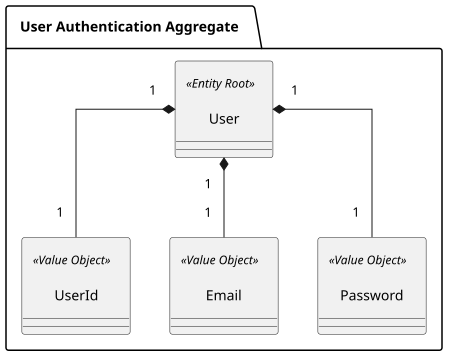
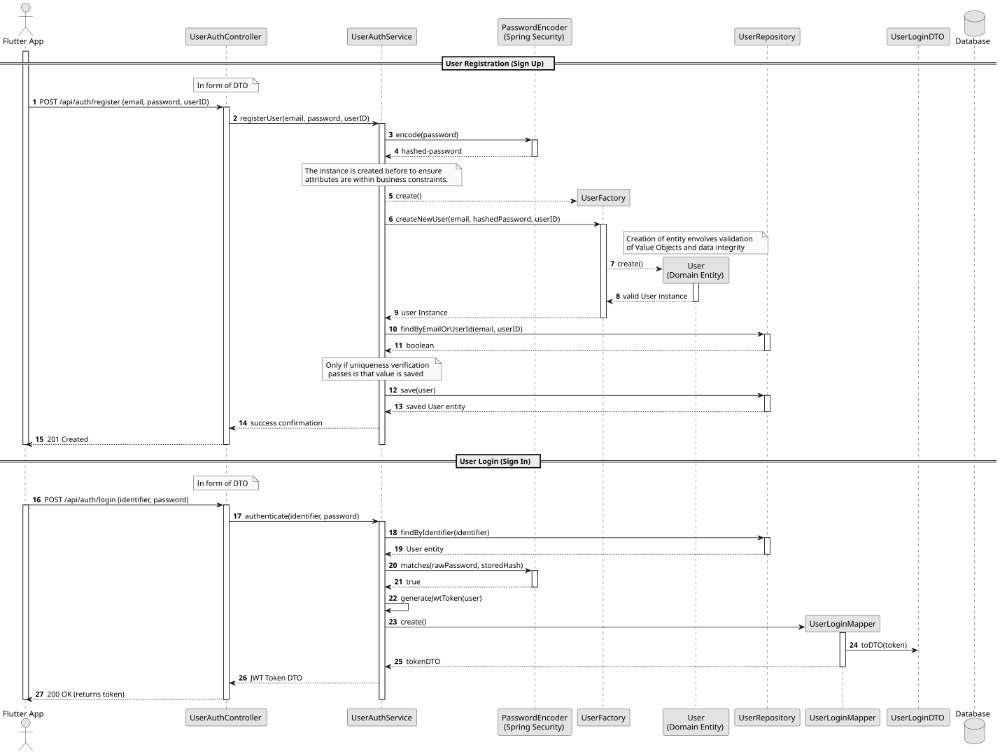

# US008 - User Account Registration and Secure Login

## 1. Requirements Engineering

##### 1.1. User Story Description
As a User, I want to create an account and log in securely, so that my personal data, custom recipes, and history are safely synchronized and saved.

##### 1.2. Use Case Specifications
**From the user story:**
- User accounts must be uniquely identified by an email address.
- Passwords must be stored securely using strong cryptographic hashing (e.g., BCrypt).
- Authentication is a prerequisite for accessing personalized features and managing personal data, meals, and progress.

**From the glossary and domain analysis:**
- **User:** The entity root representing a system user, managing authentication, profile data, and nutritional objectives within the `User Authentication Aggregate`.
- **UserId:** A unique identifier for the user.
- **Email:** A unique valid email address used for user identification, authentication, and communication within the application.
- **Password:** The confidential secret credential used to authenticate a user securely, stored in its hashed form.

##### 1.3. Acceptance Criteria
- **AC1:** The email address must be unique in the system; duplicate registrations with the same email must be rejected.
- **AC2:** The email format must be valid.
- **AC3:** The password must meet minimum security standards (e.g., length and complexity rules).
- **AC4:** Successful registration stores the user credentials securely with a hashed password.
- **AC5:** A registered user must be able to log in successfully using correct credentials, while incorrect credentials result in authentication failure.

##### 1.4. Found out Dependencies
- **None:** This is a foundational user story establishing the core authentication and user identity required by all other functional modules (such as profile creation, daily logs, and custom recipes).

##### 1.5 Input and Output Data
**Input Data:**
- *Typed data (Registration):* Email, Password, UserID.
- *Typed data (Login):* Email/UserId, Password.

**Output Data:**
- Confirmation of successful account creation / authentication token or session indicator.
- Error messages in case of validation failures (e.g., "Email already in use", "Invalid email format", "Invalid credentials").

##### 1.6. System Sequence Diagram (SSD)

##### 1.7. Assumptions and Decisions
- Account creation and authentication will use stateless or token-based session handling suitable for REST APIs interacting with a Flutter mobile client.

---

## 2. Analysis

### 2.1. Relevant Domain Model Excerpt

The following domain entities and value objects compose the `User Authentication Aggregate`:
- `User` (Entity Root)
- `UserId` (Value Object)
- `Email` (Value Object)
- `Password` (Value Object)

---

### 3.1. Rationale

To justify the architectural and technical choices made for the authentication and account management module (US008), the following table maps each design pattern and structural decision to its core engineering benefit:

| Architectural Component / Pattern      | Choice & Implementation                                                                                                            | Rationale & Benefit                                                                                                                                                    |
|:---------------------------------------|:-----------------------------------------------------------------------------------------------------------------------------------|:-----------------------------------------------------------------------------------------------------------------------------------------------------------------------|
| **Domain Factory & Value Objects**     | Encapsulation of creation logic via factory methods (`createNewUser`) and immutable Value Objects (`Email`, `Password`, `UserID`). | Ensures that a `User` aggregate can never be instantiated in an invalid state, enforcing business invariants and data integrity directly in memory before persistence. |
| **DTO (Data Transfer Object) Pattern** | Separation of API contracts using `RegisterRequestDTO`, `LoginRequestDTO`, and `JwtResponseDTO`.                                   | Shields the internal domain models from external API schema changes, controls exposed data structures, and optimizes network payload over REST/JSON.                   |
| **Repository Pattern**                 | Abstraction of data persistence using Spring Data JPA (`UserRepository`) with custom query methods.                                | Decouples business logic and domain services from database implementation details, improving testability and maintainability.                                          |
| **Declarative Transactions**           | Management of database operations via Spring's `@Transactional` annotation at the service layer.                                   | Guarantees atomicity and data consistency across multi-step operations, automatically handling commits and rollbacks in case of failure.                               |
| **Aggregate Separation**               | Decoupling core credentials (`User`) from physical metrics and onboarding goals (`UserProfile`).                                   | Permits modular development, allowing authentication to function independently and onboarding workflows to evolve without modifying core security records.             |
| **Secure Password Handling**           | Immediate hashing using Spring Security's `PasswordEncoder` (BCrypt).                                                              | Protects user credentials against data breaches by ensuring plain-text passwords are never stored in memory or the database.                                           |

### 3.2. Design Decisions & Architecture

1. **Separation of Authentication and Profile Aggregates**
   The `User` entity exclusively manages core security credentials (`Email`, `Password`, `userID`). Physical profile data and nutritional goals (`UserProfile`) reside in a separate aggregate to allow onboarding to occur independently after registration.

2. **Domain Factory Pattern & Value Object Validation**
   To maintain strict Domain-Driven Design principles, validation logic (such as checking email formats or password complexity) resides inside the immutable Value Objects. The `User` aggregate utilizes a domain factory method (`createNewUser`) to orchestrate secure creation, ensuring that raw parameters are validated and passwords are fully hashed before the entity reaches the persistence layer.

3. **DTO Pattern and Data Mapping**
   Request and response payloads are strictly handled via dedicated DTOs (`RegisterRequestDTO`, `LoginRequestDTO`, `JwtResponseDTO`). Controllers receive and return these structures, preventing direct exposure of domain entities over the REST API and keeping the architecture clean and decoupled.

4. **Repository Pattern & Spring Data JPA**
   Data access is mediated through the `UserRepository` interface extending Spring Data JPA. This abstracts away boilerplate SQL operations and provides clean query definitions (such as `findByEmailOrUserId`), allowing the service layer to interact with the database through high-level domain abstractions.

5. **Declarative Database Transactions (`@Transactional`)**
   Database transaction boundaries are managed declaratively using Spring’s `@Transactional` mechanism at the service layer. This ensures that complex registration or authentication routines execute atomically, automatically committing successful changes or rolling back operations safely if errors occur.

6. **Unique Constraints & Concurrency Handling**
   Uniqueness for identifiers like `email` and `userID` is enforced dually: at the domain service level (via repository pre-checks) and at the relational database level (via unique constraints) to prevent race conditions during concurrent sign-ups.

### 3.3. Sequence Diagram (SD)

---

## 4. Tests

Following Test-Driven Development (TDD), testing proceeds in a bottom-up approach from Value Objects up to Controllers.

### 4.1. Domain Validations (Bottom-Up Approach)

### 4.2. Application Layer & Integration Tests

---

## 5. Implementation

### 5.1. Overall Flow
1. **Request Intake:** The REST controller receives registration/login payloads.
2. **Value Object Validation:** `Email` and `Password` VOs validate format and constraints upon instantiation.
3. **Business Verification:** The service checks email uniqueness against the repository.
4. **Credential Security:** Passwords are securely hashed.
5. **Persistence:** The `User` aggregate is saved within a transactional boundary.

### 5.2. Key Methods and Classes

| Class                       | Method                                        | Responsibility                              |
|-----------------------------|-----------------------------------------------|---------------------------------------------|
| `UserAuthController`        | `register(RegisterRequestDTO)`                | Exposes registration endpoint.              |
| `UserAuthController`        | `login(LoginRequestDTO)`                      | Exposes authentication endpoint.            |
| `UserAuthService`           | `registerUser(String email, String password)` | Orchestrates user creation and persistence. |
| `UserRepository`            | `findByEmail(Email email)`                    | Queries storage for existing email.         |
| `PasswordEncryptionService` | `encode(String rawPassword)`                  | Cryptographically hashes passwords.         |