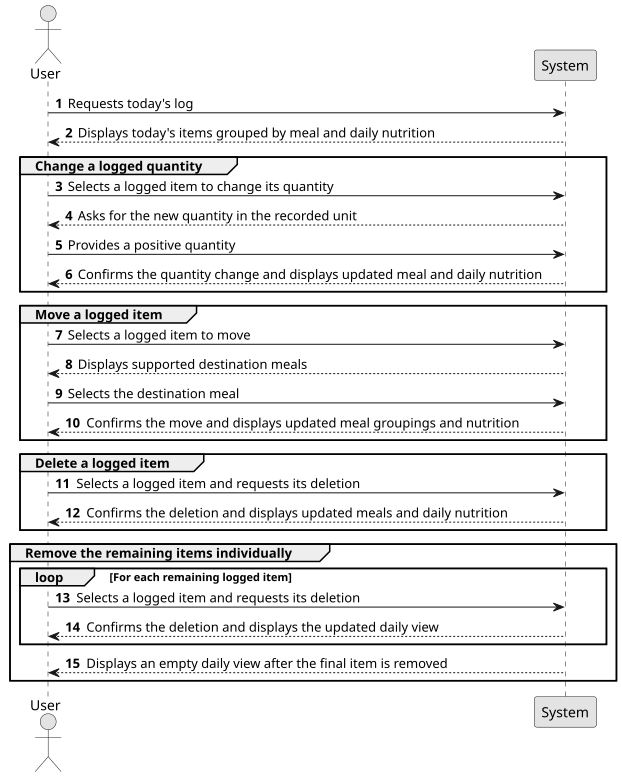
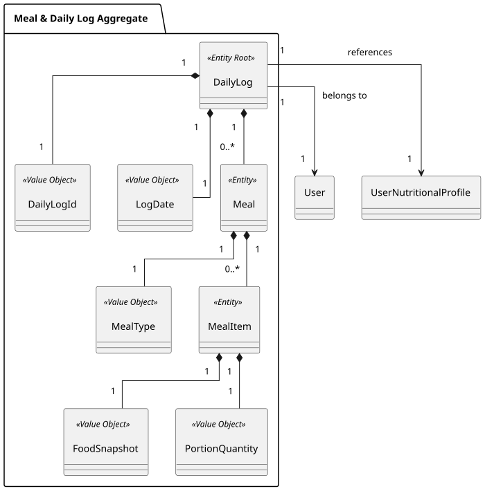
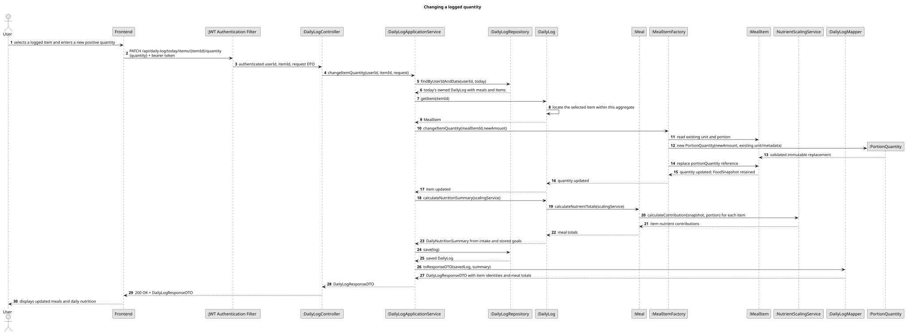
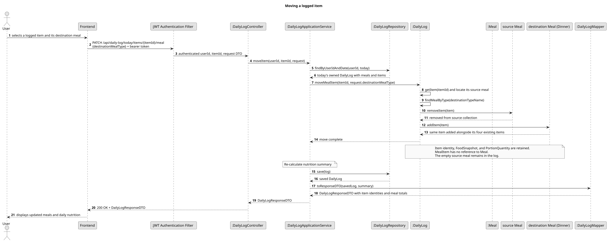
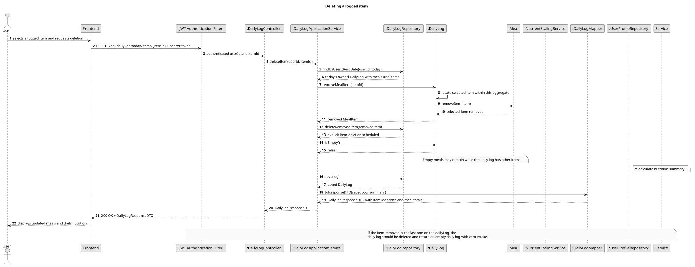

### US009 - Editing and Deleting Logs

## 1. Requirements Engineering

##### 1.1. User Story Description
As a User, I want to be able to edit or delete items I previously logged in a meal, so that I can correct mistakes or change my mind about what I ate.

##### 1.2. Use Case Specifications
**From the user story and scope clarification:**
- The authenticated user can select an individual item in today's log and change its logged quantity, move it to another supported meal, or delete it.
- These operations apply to logged foods and logged recipes. Changing a logged recipe's portion does not edit its saved recipe definition.
- Past logs cannot be edited or deleted through this story.
- Users cannot delete a meal directly. They remove its items individually until it is empty.
- Removing the final item from today's log deletes the persisted `DailyLog`. Logging again creates a new log through the existing addition flow.
- Successful changes are reflected in the affected meal totals, daily consumed totals, and remaining/over-target values.

**From the glossary and domain analysis:**
- **DailyLog (Aggregate Root):** The authenticated user's log for one calendar date. It owns its meals and meal items; only today's log can be changed by US009.
- **Meal:** A grouping of meal items under a supported `MealType`. Each supported type, including `Snacks`, has one meal grouping per daily log.
- **MealItem (Entity):** One individually selectable logged food or recipe, owning its `FoodSnapshot` and `PortionQuantity`.
- **FoodSnapshot (Value Object):** The immutable food or recipe details captured when logged, including the nutrition and serving data used to calculate its contribution.
- **PortionQuantity (Value Object):** A positive logged amount with its unit. A quantity correction changes the amount of the selected entry.
- **DailyGoalSnapshot (Value Object):** The targets stored with the daily log. Item changes affect intake and remaining values, not nutritional goals.
- **DailyNutritionSummary:** Consumed calories, protein, carbohydrates, and fat, together with targets and remaining/over-target values derived from the log.

##### 1.3. Acceptance Criteria
- **AC1:** An authenticated user can select a specific item in their own log for today and change its quantity, move it between supported meals, or delete it.
- **AC2:** A quantity change accepts a positive amount, including fractions supported by existing logging rules, and retains the item's recorded unit and food snapshot. Zero, negative, missing, or unrepresentable amounts are rejected; deletion is a separate action.
- **AC3:** Moving an item changes its meal grouping while retaining its food snapshot and portion quantity. The item occurs exactly once after the move. Supported destinations are `Breakfast`, `Lunch`, `Dinner`, and `Snacks`, respecting the existing meal grouping rules.
- **AC4:** Deleting an item removes only the selected entry, including when other entries represent the same food or recipe.
- **AC5:** After a successful change, the affected meal totals, daily calories and macros consumed, and remaining/over-target values reflect the updated log. A move alone does not change daily intake.
- **AC6:** Logged recipes support portion-quantity changes, moves, and deletion in the same way as other logged items. Their stored recipe nutrition is used without changing or reloading the saved recipe definition.
- **AC7:** Past logs are immutable through US009. The application determines today's date using its configured clock and timezone and rejects changes to any other date.
- **AC8:** A user cannot modify another user's log or select an item outside their own current-day log. Missing or no-longer-present items produce an error without changing another entry.
- **AC9:** No direct meal-deletion operation is provided. A user empties a meal by removing its individual items.
- **AC10:** Deleting the final item deletes today's persisted `DailyLog` and its owned meal/item records. The daily view then follows US004's empty, non-persisted state. Logging again creates a new log with the goals active at that time.
- **AC11:** Quantity changes, moves, and deletions preserve the existing daily target snapshot while the log exists. Replacing the selected food, changing its nutrition, editing recipe definitions, and changing the log date are outside scope.
- **AC12:** Validation or persistence failure leaves no partially applied quantity change, move, item deletion, or final-log deletion.

##### 1.4. Found out Dependencies
- **US004 (Meal Logging and Daily Tracking):** Supplies today's log, meal groupings, logged items, portion validation, snapshot-based nutrient calculation, daily summaries, and creation on first addition.
- **US005 (Daily History):** Continues to display past logs without allowing changes. US009 must preserve historical food and target snapshots.
- **US006 (Custom Foods and Recipes):** Supplies logged recipe entries whose portion can be corrected or whose entry can be moved/deleted independently of the source recipe.
- **US008 (Authentication and Account Management):** Supplies the authenticated identity used to enforce ownership.
- **US001/US002 (Nutritional Profile and Goals):** Supply the active goals when logging recreates a daily log after its final item was deleted. Existing goal-refresh behavior remains applicable while today's log exists.

##### 1.5. Input and Output Data
**Input Data:**
- Authenticated user identity from the security principal.
- Identity of the selected logged item, with sufficient log/meal context to identify the exact entry and validate membership in today's log.
- Requested operation: change quantity, move, or delete.
- For a quantity change: the new positive amount in the entry's existing unit.
- For a move: the destination meal type name, which uniquely selects its grouping within the daily log.

**Output Data:**
- Confirmation of the completed operation.
- Updated meal groupings, logged quantities, per-meal totals, daily consumed totals, targets, and remaining/over-target values.
- An empty current-day view when deletion removes the final logged item.
- Validation, missing-item, authentication/ownership, current-day restriction, and persistence errors as applicable.

##### 1.6. System Sequence Diagram (SSD)

##### 1.7. Assumptions and Decisions
- Scope is limited to today's logged items. Historical logs remain read-only, and the server determines the current date using the existing application clock and timezone.
- Quantity editing changes the numeric amount in the existing unit. Switching units, replacing foods, editing snapshot details, and changing recipe definitions are outside this story.
- Each operation targets an individual logged entry rather than matching by food name, barcode, or recipe name. Duplicate entries must remain independently selectable.
- A move uses the meal types and grouping behavior already established in US004. Users do not create custom meal types or delete meals directly.
- An empty meal contains no intake and may remain while its daily log has other items. The final item deletion deletes the whole daily log. No user-facing meal-deletion action is introduced.
- Changes use the persisted food snapshot and portion data, with no dependency on current catalog availability or the current recipe definition.
- A logged recipe remains one meal item. Its logged serving quantity can change without editing recipe yield, ingredients, or saved nutrition.
- Totals are derived from the remaining items and their quantities. Remaining values equal the stored targets minus consumed intake; negative values continue to indicate an exceeded target.
- The final item deletion removes the daily log rather than retaining an empty persisted aggregate. This matches US004's create-on-first-item lifecycle. A subsequent addition creates a new log and snapshots the then-active goals, which may differ from those in the deleted log.
- Changes must be persisted atomically through the daily log's ownership boundary. Endpoint shapes, item/meal identity exposure, and persistence mechanics are deferred to design.

## 2. Analysis

### 2.1. Relevant Domain Model Excerpt
The existing `DailyLog` aggregate owns the meals and their individual `MealItem` entities. Each item owns a food snapshot and portion quantity; daily and per-meal nutrition are calculated from these values. This boundary supports correcting an item's amount, moving it between the log's meals, or removing it while keeping the log consistent.

Logged recipes already use an independent `FoodSnapshot` containing their log-time name, serving definition, and nutrition. US009 changes the logged entry, with no need to modify or reference the source recipe aggregate.

Logged-item responses expose `itemId`, allowing duplicate food/recipe entries to be selected independently. `Meal` manages its items through a unidirectional collection; `MealItem` has no parent reference. `DailyLog` locates the selected item and coordinates membership changes between its meals. Collection removal and entity deletion are separate persistence operations.

The final deletion ends the aggregate's lifecycle, including its owned meal records. Other item changes retain the log's date, owner, and target snapshot. Historical logs remain readable through US005 and outside the mutation scope.

## 3. Design

### 3.3. Sequence Diagram (SD)

The following diagrams show successful operations only. Quantity corrections use `MealItemFactory` to create a new immutable `PortionQuantity` and replace the item's previous value-object reference. Quantity changes, moves, and deletions are implemented. Moves preserve the existing entity; deletion explicitly removes it through the aggregate repository.

**Changing a logged quantity**

**Moving a logged item**

**Deleting a logged item**

## 4. Tests

## 5. Implementation

### 5.1. Changing a Logged Quantity

- `PATCH /api/daily-log/today/items/{itemId}/quantity` accepts `{ "quantity": 2.5 }` and returns the updated `DailyLogResponseDTO`. Logged-item responses include `itemId` so duplicate foods or recipes can be selected independently.
- `DailyLogApplicationService.changeItemQuantity` loads the authenticated user's log for today using the configured clock, then asks `DailyLog.getItem` to locate the entry within that aggregate. Missing, foreign, and historical items return `404` without revealing another user's data.
- `MealItemFactory.changeItemQuantity` receives the located entity, creates a replacement `PortionQuantity` with the existing unit and metadata, and asks the entity to replace its reference. The previous value object, item identity, food snapshot, and log target snapshot remain unchanged.
- Quantities must be positive and fit existing `decimal(12,4)` storage. Invalid amounts return `400`; unauthenticated requests return `401`.
- Nutrition is recalculated from stored snapshots, and the log is saved in one transaction. Catalog and recipe-definition lookups are not required.
- The CLI's daily-log menu offers **Change a logged quantity**, with individual entry selection and input in the recorded unit.

### 5.2. Meal Ownership, Moves, and Deletions

- `Meal.items` owns the existing non-null `meal_id` foreign key through a unidirectional `@OneToMany` and `@JoinColumn`. `MealItem.meal` and `attachTo` are removed. Tables and item identities remain unchanged; no join table is introduced.
- `DailyLog.addMealItem` reuses one meal per type, including Snacks, and rejects duplicate or already-persisted item attachment. Move operations use `DailyLog.moveMealItem` instead.
- `PATCH /api/daily-log/today/items/{itemId}/meal` accepts `{ "destinationMealType": "Dinner" }`. The aggregate finds the destination by name; when absent it creates a meal with a new type VO. Moving to the current meal is a no-op. The existing item's identity, snapshot, and quantity are retained.
- `DELETE /api/daily-log/today/items/{itemId}` removes the selected item through `DailyLog.removeMealItem`. `DailyLogRepository.deleteRemovedItem` explicitly schedules entity deletion via its persistence fragment.
- `Meal.items` retains cascade operations but disables orphan removal, so moving an item does not schedule its deletion. Empty source meals remain. Deleting the final daily item deletes the aggregate, including all remaining empty meal rows, and returns US004's empty view using current profile targets.
- Both operations scope lookup to the authenticated owner and today's server-derived date and run within a transaction. The CLI offers individual move/delete actions.
- Existing databases may contain legacy repeated Snacks meal rows. The integration test includes inline SQL that consolidates duplicate log/type groupings while retaining every item ID, snapshot, and quantity. This SQL runs only against the isolated test database; no automatic migration of saved user data is performed.

### 5.3. Validation

- Database integration tests verify moves to existing/new destinations, same-meal moves, one Snacks grouping after repeated additions, explicit deletion, final-log deletion/recreation, aggregate cascades, non-null foreign keys, and rollback after flush.
- API tests cover authentication, foreign/historical/missing items, invalid destinations, stored targets, and snapshot-based totals. Factory tests retain immutable quantity replacement coverage; CLI tests cover all three edit choices.
- The inline legacy consolidation SQL is tested with duplicate meal rows and checks preserved item identities and intake.
