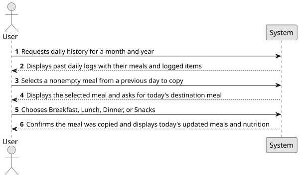
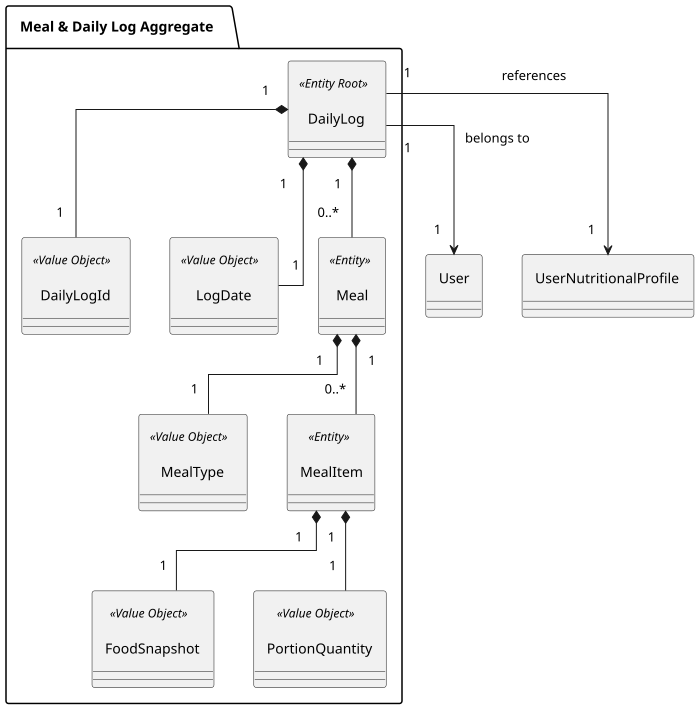
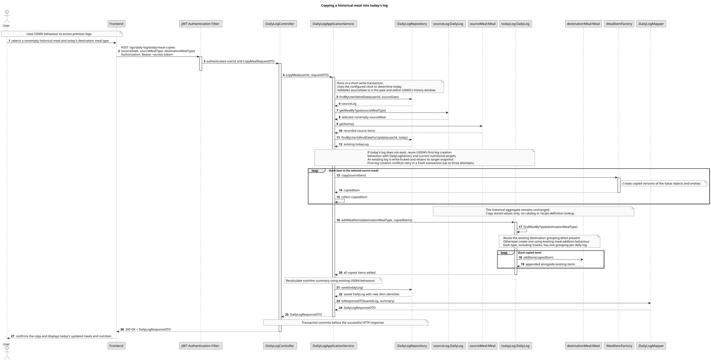

### US010 - Meal Duplication

## 1. Requirements Engineering

##### 1.1. User Story Description
As a User, I want to be able to copy a meal from a previous day into my current day, so that I can save time logging repetitive meals (like breakfast or snacks).

##### 1.2. Use Case Specifications
**From the user story and scope clarification:**
- The authenticated user browses their past logs through US005 and selects a nonempty meal to copy into today.
- Copying includes every item in the selected meal, with the food or recipe details, portion amounts, and units recorded on the source day.
- The user chooses a destination meal type: `Breakfast`, `Lunch`, `Dinner`, or `Snacks`. The destination can differ from the source type.
- The copied items are added alongside any items already logged in the destination meal; existing entries are never replaced or merged.
- The user may copy the same meal repeatedly. Each completed copy adds a separate set of entries.
- The historical log remains unchanged. The copied entries belong to today's log and can subsequently be changed through US009.
- If today has no persisted log, copying creates it with the user's current nutritional targets, following US004's first-item behavior.
- The updated daily view shows the resulting meal contents, consumed nutrition, targets, and remaining/over-target values.

**From the glossary and domain analysis:**
- **DailyLog (Aggregate Root):** One user's record for one calendar date, owning its meals, logged items, and daily target snapshot. Duplication reads a past log and adds entries to today's log.
- **Meal:** A grouping of logged items under a supported `MealType`. Each type, including `Snacks`, has one grouping per daily log; a grouping may contain multiple items.
- **MealItem (Entity):** One logged food or recipe entry. A copied entry has its own identity and lifecycle within today's log.
- **FoodSnapshot (Value Object):** The food or recipe details captured when logged, including name, optional brand/barcode, nutrient values and basis, and serving definition. Copying preserves these recorded values.
- **PortionQuantity (Value Object):** The recorded positive amount, unit, and any portion metadata used to calculate an entry's contribution.
- **DailyGoalSnapshot (Value Object):** The calorie and macronutrient targets associated with a daily log. Historical targets are not copied with a meal.
- **DailyNutritionSummary:** Consumed calories, protein, carbohydrates, and fat, together with the destination day's targets and remaining/over-target values.

##### 1.3. Acceptance Criteria
- **AC1:** An authenticated user can select a nonempty meal from their own past logs in US005's history view and request to copy it into today.
- **AC2:** The source date must precede today and fall within US005's supported history window. Today's date and the history boundary are determined by the application's configured clock, timezone, and history configuration.
- **AC3:** The user can choose any supported destination type: `Breakfast`, `Lunch`, `Dinner`, or `Snacks`, including a type different from the source meal.
- **AC4:** One successful copy adds a new entry for every item in the selected source meal. Each entry retains the source item's recorded food/recipe snapshot, quantity, unit, and portion metadata, with a new item identity.
- **AC5:** Copying appends to the destination meal without removing, replacing, or combining existing entries. Repeated copies of the same meal are allowed and produce additional independently selectable entries, including duplicate foods or recipes.
- **AC6:** Copying into a type already present today reuses that meal grouping. If it does not exist, the destination grouping is created. Repeated additions to Snacks do not create additional Snacks groupings.
- **AC7:** If today's log does not exist, a successful copy creates and persists it using the current profile's targets under US004's existing prerequisites. If today's log exists, the operation retains its target snapshot. The source day's targets are never copied.
- **AC8:** The resulting per-meal and daily nutrition includes all copied entries and any previously logged entries. Remaining values use today's targets minus the resulting consumed totals, including negative values when targets are exceeded.
- **AC9:** Copying uses the persisted historical snapshots without retrieving current catalog food details or recipe definitions. A later source-food or recipe change or unavailability does not prevent copying an otherwise valid logged meal.
- **AC10:** The source log, meals, items, quantities, and targets remain unchanged. Editing, moving, or deleting a copied entry through US009 affects only today's copy.
- **AC11:** Empty meals cannot be copied. Missing source logs/meals, unsupported destinations, and invalid or out-of-window source dates produce an error without changing today's log.
- **AC12:** The operation reads only the authenticated user's history and writes only that user's current-day log. A user cannot copy another user's meal or choose a different destination date or owner.
- **AC13:** The entire meal is copied atomically. A validation or persistence failure leaves no partially copied entries or newly persisted empty daily log.

##### 1.4. Found out Dependencies
- **US004 (Meal Logging and Daily Tracking):** Supplies daily log creation, supported meal groupings, snapshot-based nutrition calculation, and the updated daily view.
- **US005 (Daily History):** Supplies the history browsing flow, selectable historical meals, and the supported history window.
- **US006 (Custom Foods and Recipes):** Supplies logged recipe snapshots that are copied as complete logged entries without accessing their current recipe definitions.
- **US008 (Authentication and Account Management):** Supplies the authenticated identity used to scope source history and destination ownership.
- **US009 (Editing and Deleting Logs):** Allows the user to correct quantities, move, or delete the newly copied entries in today's log. It also establishes single meal groupings and the daily-log lifecycle after final-item deletion.
- **US001/US002 (Nutritional Profile and Goals):** Supply current nutritional targets when copying creates today's log. Existing daily target refresh rules remain applicable.

##### 1.5. Input and Output Data
**Input Data:**
- Authenticated user identity from the security principal.
- History month/year selection through US005.
- Selected source log date and meal selection, sufficient to identify the nonempty meal in the user's saved history.
- Supported destination meal type name.
- The destination date is derived on the server; copied nutrient values and quantities come from the stored source entries rather than client-supplied replacements.

**Output Data:**
- Confirmation that the selected meal was copied into today's chosen meal grouping.
- Today's updated meals and items, including identities for the new entries and their recorded quantities/units.
- Updated per-meal and daily calories, protein, carbohydrates, and fat; today's targets and remaining/over-target values.
- Validation, missing-source, empty-meal, authentication/ownership, missing-profile, and persistence errors as applicable.

##### 1.6. System Sequence Diagram (SSD)

[PlantUML source](puml/US010_SSD.puml)

##### 1.7. Assumptions and Decisions
- The user starts from US005's history view. Its configurable history window applies to source selection; the current implementation defaults to a 10-year lookback measured by month. Source dates must still be strictly before today, including when browsing the current month.
- A copy includes the entire selected meal exactly as recorded. Selecting individual source items, changing quantities during the copy, scaling the whole meal, copying a whole day, and copying from today are outside scope.
- Any supported destination type may be selected. The destination meal's type does not need to match the source meal's type.
- Copying appends entries and never replaces today's meal. Existing and copied duplicates remain distinct; no deduplication or quantity merging occurs.
- Each deliberate repeated copy adds the full selected meal again. Users can correct the result afterward with US009.
- Logged recipes are copied as their single logged snapshot entries, not expanded into ingredients or refreshed from current recipe definitions.
- Copied items receive new identities and independently owned snapshot/portion values. Historical entities are not moved or reused as today's entities, and neither day retains a live dependency on the other's items.
- Empty historical meal groupings are unavailable for copying. Missing or invalid sources do not create a destination log or meal.
- Historical targets belong to the source daily log and are excluded from the copy. Existing current-day targets are retained; first-log creation snapshots the then-active profile goals.
- US005's history retrieval remains read-only. The copy action reads history and changes only today's log; it does not grant editing rights over past logs.
- API contracts, factories, transaction mechanics, and detailed interaction diagrams are deferred to design.

## 2. Analysis

### 2.1. Relevant Domain Model Excerpt
Meal duplication uses the existing `DailyLog` aggregate on both dates: the historical aggregate supplies the selected meal's recorded values, while today's aggregate owns the newly created entries. Only today's aggregate is changed. No additional aggregate or persistent association between the two days is required by this story.

`Meal` manages its `MealItem` collection, and each item owns a `FoodSnapshot` and `PortionQuantity`. Copying must create new meal-item entities from the source values rather than attach historical entities to a second meal. The copied value objects preserve recorded nutrition and portion semantics without modifying their source values. This applies equally to logged foods and logged recipes.

Today's destination type selects one meal grouping within the destination log. Appending all new items preserves existing intake and supports repeated copies. US009 can identify and change each resulting entry independently without touching the historical source.

The source meal's stored values provide everything needed to calculate the added intake. The source log's target snapshot is not part of a meal copy: summaries use today's existing targets or the current goals captured when today's log is first created. History browsing, ownership checks, and date eligibility must remain consistent with US005.

## 3. Design

### 3.3. Sequence Diagram (SD)

The diagram shows the successful copy into an existing current-day log. US005 history browsing, US004 first-log creation, and existing nutrition-summary calculation are referenced through notes. The implementation follows this flow, including factory-owned creation of independent copied entities and value objects.

[PlantUML source](puml/US010_SD.puml)

## 4. Tests

### 4.1. Domain and Factory Tests

- Factory copies create distinct `MealItem`, `FoodSnapshot`, and `PortionQuantity` objects with equal recorded values and no source identity. Coverage includes fractional values, nutrient precision, servings, grams, milliliters, and named-portion metadata.
- Changing a copied portion leaves the source value object unchanged.
- Batch addition rejects already-owned or repeated entity instances before appending entries or creating a destination meal.

### 4.2. Application Layer and Integration Tests

- Copy a full meal into an existing destination, preserving its entries and targets. Repeat the copy and verify new, independently selectable item IDs and a single Snacks grouping.
- Create today's first log and a previously absent destination using active profile targets. Reload persisted values to verify independent snapshots and portion metadata.
- Verify calorie and macro totals, remaining values, and the unchanged historical record, including after quantity edits, moves, and deletion of a copied entry through US009.
- Reject unauthenticated requests, foreign/missing sources, empty meals, unsupported types, malformed requests, today's/future dates, and sources outside the configured history window. Verify the month-based boundary matches US005 and today's date uses the configured timezone.
- Missing profiles prevent first-log creation without leaving an empty log. Failures after saving and flushing roll back new items, meal groupings, and any newly created log for both existing-log and first-log flows.
- Verify copying performs no catalog or recipe-definition lookup.
- CLI tests cover nonempty source selection through history, destination choice, repeated copies, cancellation, and unavailable selections.

## 5. Implementation

### 5.1. Overall Flow

1. The user browses US005 history and selects a nonempty meal and destination type. `DailyHistoryUI` offers the copy action after displaying the selected month's logs and permits repeated copies.
2. `DailyLogController` accepts `POST /api/daily-log/today/meal-copies` with `{ "sourceDate": "2026-11-14", "sourceMealType": "Breakfast", "destinationMealType": "Snacks" }`. The authenticated principal supplies ownership; the body does not supply destination date, item quantities, or nutrition.
3. `DailyLogApplicationService.copyMeal` derives today from the configured clock and validates source eligibility. `LogHistoryWindow` shares month-boundary validation with US005 using `daily-log.history.max-lookback-years`.
4. The service loads the owner's source log and asks `DailyLog.getMealByType` for the selected nonempty meal. `MealItemFactory.copy` creates each new entity and its independently owned snapshot/portion values from the recorded source.
5. The service loads or creates today's log using the same creation helper as normal logging. `DailyLog.addMealItems` appends the new items to the chosen grouping, creating it if needed.
6. Existing nutrition calculation and response mapping return the updated daily view. Source lookup, destination changes, persistence, and mapping run within one transaction; only today's aggregate is saved.

### 5.2. Responses and Persistence

- Success returns `200 OK` with `DailyLogResponseDTO`, including new item identities, meal totals, targets, and remaining values.
- Invalid requests, ineligible dates, and empty source meals return `400`. Missing or foreign source logs/meals return the same `404` response. Authentication is required (`401`), and creating a first log without a profile returns the existing `409` profile-required response.
- No database schema changes or persistent associations between source and destination are introduced. The historical log's targets, items, and snapshots remain unchanged.

### Daily Log Write Consistency

Current-day mutations use an owner/date-scoped root write lock. First-log creation uses the user/date uniqueness constraint and bounded transaction retries; meal types are unique within each log. Catalog/recipe DTO resolution precedes the write transaction, and factories create fresh entities and value objects inside each attempt. See [Daily Log Write Consistency](../US004/dailyLogWrites.md) for transaction boundaries, timeout handling, and concurrent-write validation.
